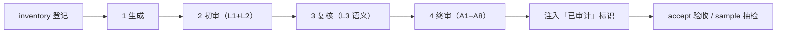

# 审计报告标准化管理体系（AUDIT-MGMT v1.0）

> **定位**：把**全部真实业务产生的报告**纳入标准化管理，按正式审计报告编制规范统一生成与编排，建立多层级信息校验、四环节质量管控（生成→初审→复核→终审）、统一的「已审计」标识与定期抽检机制。
>
> **与 `engine/quality/` 的分工**：`engine/quality/` 管**内容质量评估**（四维 21 指标、15 类混乱、修复闭环）；本体系管**报告的标准化与审计管控**（编制规范、校验层级、审查流程、标识与验收）。两者互补：内容问题走 `engine/quality/` 修复，报告合规走本体系。

---

## 一、体系构成

| 文件 | 职责 | 对应要求 |
|---|---|---|
| [report-standard.md](./report-standard.md) | 编制规范：十大要素、统一结构骨架、表述逻辑、签发要素 | 要求 2 |
| [verification.md](./verification.md) | 多层级校验：L1 机器 / L2 结构要素 / L3 语义（准确性·可追溯·一致性） | 要求 3 |
| [review-workflow.md](./review-workflow.md) | 质量管控流程：生成→初审→复核→终审，全程留痕 | 要求 4 |
| [audit-mark.md](./audit-mark.md) | 「已审计」标识规范（显著位置、状态区分） | 要求 5 |
| [acceptance.md](./acceptance.md) | 质量验收标准（A1–A8）+ 定期分层抽检 | 要求 6 |
| [scripts/audit_tool.py](./scripts/audit_tool.py) | 工具：登记/L2 校验/留痕/标识/抽检/验收 | 全部 |
| [prompts/](./prompts/) | 审计流程提示词（主控 + 四环节） | 要求 4 |
| [records/](./records/) | 登记表 `audit_registry.json` + 审查记录 `reviews/` + 备份 `backups/` | 要求 1·4 |

---

## 二、闭环流程



---

## 三、快速开始

```bash
python engine/audit/scripts/audit_tool.py inventory          # 列出全部报告
python engine/audit/scripts/audit_tool.py init               # 登记全部报告
python engine/audit/scripts/audit_tool.py structure <report> # L2 要素校验
python engine/audit/scripts/audit_tool.py verify <report>    # L1+L2 汇总
python engine/audit/scripts/audit_tool.py review <report> --stage initial --reviewer agent --decision pass
python engine/audit/scripts/audit_tool.py review <report> --stage second  --reviewer agent --decision pass
python engine/audit/scripts/audit_tool.py review <report> --stage final   --reviewer agent --decision pass
python engine/audit/scripts/audit_tool.py mark <report>      # 四环节齐备 → 注入标识
python engine/audit/scripts/audit_tool.py run                # 确定性四环节（CI 用，幂等）
python engine/audit/scripts/audit_tool.py accept             # 项目级验收
python engine/audit/scripts/audit_tool.py sample --ratio 0.2 # 定期抽检
```

## 三·五、CI / 定期任务接入

| 触发 | 环节 | 执行者 |
|---|---|---|
| push/PR 触及 `**/reports/*`、`engine/audit/**` | 生成→初审（L1+L2）→复核（L3 确定性子集）→终审（A1–A8 确定性项）→注入标识 | `.github/workflows/audit.yml`（`audit_tool.py run`，幂等，自动提交记录与标识） |
| 定期 | L3 语义深度复核（准确性/可追溯/一致性全量）+ 终审签发 | Agent（`prompts/30-second-review.md`、`prompts/40-final-review.md`） |

> CI 无法运行 LLM，故四环节拆为「CI 确定性执行 + Agent 深度复核」；`run` 的证据串标注「语义深度复核由 Agent 定期执行」。
> 与 `content-update` / `html-sync` / `scheduled-maintenance` 共用并发组 `auto-commit-main`。

### 妙手定时任务（已配置）

| 项 | 值 |
|---|---|
| 名称 | 审计 L3 深度复核与终审 |
| 计划 | 每周一 09:00（`RRULE:FREQ=WEEKLY;BYDAY=MO;BYHOUR=9;BYMINUTE=0`，Asia/Shanghai） |
| 执行 | `engine/audit/prompts/50-periodic-deep-review.md`（L3 深度复核 → 终审签发 → 标识 → 验收抽检 → 提交推送） |
| 状态 | ACTIVE |

管理：`paw automation list|get|pause|resume|delete`（**禁止直写 automation.json**）。

---

## 四、审计状态机

```
draft（编制）→ in-review（审查中）→ audited（已审计）
                                    ↘ rejected（驳回）
```

- 状态与审查链存于 `records/audit_registry.json`；
- 标识 = 审计状态的唯一权威呈现，与 registry 不一致即合规违规（P0）。

---

## 五、版本记录

| 版本 | 日期 | 变更 | 说明 |
|---|---|---|---|
| v1.0 | 2026-11-14 | 初始版本 | 建立编制规范、三层级校验、四环节管控、已审计标识与验收抽检 |
