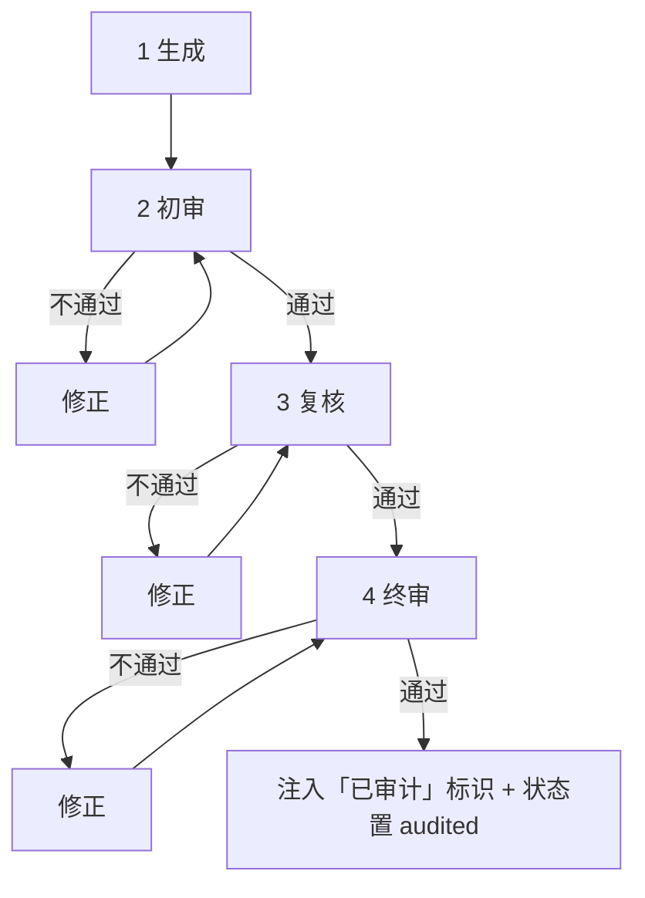

# 审计质量管控流程（REVIEW-WORKFLOW v1.0）

> **定位**：覆盖「报告生成 → 初审 → 复核 → 终审」全环节的质量管控流程。全程留痕、合规有效、可追溯。
>
> **状态机**：`draft（编制）→ in-review（审查中）→ audited（已审计）/ rejected（驳回）`。状态由 `engine/audit/records/audit_registry.json` 承载。

---

## 一、四环节职责

| 环节 | 触发 | 审查内容 | 通过条件 | 输出 |
|---|---|---|---|---|
| **1 生成** | 业务运行产出报告 | 落盘命名、结构骨架、页头要素 | L1 + L2 结构通过 | 报告 + 版本号 |
| **2 初审** | 生成后 | 要素完整性、来源合规、命名/归属 | L2 全项通过、L1 无新增错误 | 初审记录 |
| **3 复核** | 初审通过后 | 数据一致性、口径、逻辑、准确性/可追溯 | L3 通过 | 复核记录 |
| **4 终审** | 复核通过后 | 批准发布、签发、状态置「已审计」 | 前三环节齐备且通过 | 签发记录 + 注入标识 |

> **不得跳级**：任一环节不通过 → 记录 findings 并回退至相应环节；终审前必须四环节记录齐备。

---

## 二、流程



---

## 三、审查记录（留痕）

每个环节的每次审查写入 `engine/audit/records/reviews/<report-slug>.json`：

```json
{
  "report": "content/economy/dubai/apartment/reports/2026-11_monthly.html",
  "reviews": [
    {
      "stage": "draft|initial|second|final",
      "reviewer": "agent|human:<name>",
      "timestamp": "2026-11-14T...",
      "decision": "pass|fix|reject",
      "findings": [{"id": "...", "severity": "P0|P1|P2", "desc": "..."}],
      "evidence": "...",
      "levels": ["L1", "L2", "L3"]
    }
  ]
}
```

**留痕纪律**：
1. 记录只追加，不修改、不删除（修订以新记录覆盖式补充）。
2. 每条 finding 可回溯到报告位置与证据。
3. 终审签发含「签发人 + 日期 + 登记编号」。

---

## 四、登记表（`audit_registry.json`）

```json
{
  "schema_version": "1.0",
  "reports": {
    "<报告相对路径>": {
      "title": "...",
      "kind": "business|audit",
      "business_line": "...",
      "status": "draft|in-review|audited|rejected",
      "audit_id": "AUD-YYYY-MM-DD-NNN",
      "stages": {"draft": true, "initial": true, "second": true, "final": true},
      "audited_at": "...",
      "mark": true
    }
  }
}
```

---

## 五、合规有效性

- **全程留痕**：四环节记录 + 登记表 + 报告内标识三者一致。
- **可追溯**：任一状态可回溯到记录与证据。
- **不可跳级**：工具在 `mark` 时校验 stages 齐备，缺环节拒绝注入标识。
- **不可回退**：状态由 `audited` 回退须新增「重新审查」记录并说明原因。

---

## 六、版本记录

| 版本 | 日期 | 变更 | 说明 |
|---|---|---|---|
| v1.0 | 2026-11-14 | 初始版本 | 四环节状态机、留痕格式、登记表与合规有效性 |
