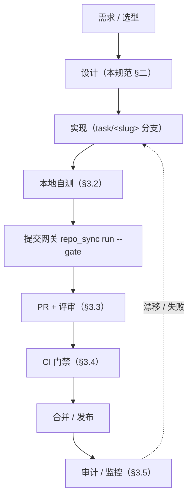

# 架构开发规范与流程指引（ARCHITECTURE-DEV-STANDARD v1.0）

> **状态**：现行规范
> **定位**：tech-context-digest 全部代码与内容开发的**架构约束 + 设计准则 + 流程与评审节点 + 验收标准**单一入口。与 [AGENTS.md](../../AGENTS.md) 同级生效；本规范未覆盖的细节引用专用规范（见 §七）。
> **事实源关系**：本规范定义「必须遵守的架构规则」；[目录结构与命名规范](./structure-and-naming-spec.md) 定义命名；[报告全链路体系](./report-pipeline-system.md) 定义流程；[页面构建规范](./page-build-spec.md) 定义页面；[多会话 Git 协议](./multi-session-git-protocol.md) 定义协作。
> **适用**：任何 Agent 平台 / 协作者在本仓库的任何新增、修改、删除动作。
> **配套评估**：[软件架构全面评估](../report-audits/architecture-assessment-2026-11-16.md)
> **最后更新**：2026-11-16

---

## 一、架构约束（硬性，不可协商）

### 1.1 三层不跨层

| 层 | 根 | 只放 | 禁止 |
|---|---|---|---|
| 内容层 | `content/` | 业务专属：报告、业务提示词、`business-config.md`、业务脚本 | 跨主题工具、通用模板、清洗后数据 |
| 引擎层 | `engine/` | 跨主题复用：模板、提示词、工具、词库、质量、审计、测试、规范 | 业务关键词、业务正文 |
| 资产层 | `data/` | `raw/` 原始抓取、`processed/` 清洗后台账、`assets/` 图片图表 | 代码、报告、手写台账 |

**判定速判**：只服务一条业务线 → `content/`；服务多条业务线 → `engine/`；可被程序读写且属研究数据 → `data/`；机器生成留痕 → `engine/audit/records/`。

### 1.2 目录与命名

- 目录 kebab-case（正则 `^[a-z0-9]+(?:-[a-z0-9]+)*$`，事实源 `engine/tools/layout.json`），深度 ≤ 6。
- **维度优先级（硬性）**：含 `region` 维度的主题，`category` 恒先于 `region`；`dimensions` 中 `category` 必须写在 `region` 之前；地区段必须命中 `regions` 白名单（当前 `dubai` / `global`）。
- 报告 `<period>_<cycle>.html`；提示词 `business-config.md` + `prompt-<cycle>.md`；模板 `prompt-<cycle>-template.md`；Python `snake_case`；数据主体 `snake_case` + 可选周期后缀。
- 新增文件必须合规；legacy 冻结项不改名（见 naming spec §十一）。

### 1.3 单一事实源（禁止复述）

| 内容 | 唯一事实源 | 其余位置 |
|---|---|---|
| 目录维度 / 主题 / 深度 | `engine/tools/layout.json` | 只写指针 |
| 报告样式令牌 | `engine/tools/report_style.py::CANONICAL_CSS` | 只写指针 |
| hub 样式令牌 | `engine/tools/build_hub.py::_STYLE` | 只写指针 |
| 类型与节拍 | `engine/templates/template-registry.md`（+ 本规范 §1.5 登记） | 只写指针 |
| 机构分级 | `engine/tools/institution_tiers.json` | 只写指针 |
| 指标 | `engine/tools/metrics-dictionary.json` | 只写指针 |
| 内容规范 | `engine/templates/information-layering-spec.md` / `decision-delivery-spec.md` | 只写指针 |
| 业务实例 | 各业务线 `prompts/business-config.md` | 只写指针 |

**禁止**：在 AGENTS.md / 规范 / 报告中复述上述事实的数值或清单；只允许「指针 + 一句适用范围」。

### 1.4 依赖方向

```
content/  ──只读──>  engine/tools（发现 / 校验 / 生成）
engine/   ──读写──>  data/
任何层     ──禁止──>  跨层反向依赖（engine 不得依赖某条业务线内部结构）
```

- 工具共享逻辑只能放 `engine/tools/_common.py`（或后续独立 core 包），**不得**复制进业务线。
- 新增跨工具调用必须走「包内 import」，禁止 `sys.path.insert` + 裸模块名（迁移期见 §五 并行期）。
- 生成物（`engine/audit/records/**`、`engine/vocabulary/data/**`、`data/raw/**`）**不得手工编辑**；改命名改生成器。

### 1.5 类型登记（单一登记，多处生成）

新增报告类型只需改一处：在 `engine/tools/` 新增 `type-registry.json`（或在 `layout.json` 增 `types` 段），字段：

```json
{
  "type_id": "example-type",
  "name": "示例类型",
  "short": "示例",
  "cadence": ["baseline", "monthly"],
  "template_dir": "engine/templates/<类型目录>",
  "compliance": "engine/templates/compliance-rules.json"
}
```

由登记生成 / 校验：`template-registry.md` 第二节、`compliance-rules.json`、`_common.TEMPLATE_TYPE_DIRS`、`build_hub.TYPE_SHORT`、`classify_reports.TYPE_CADENCE`。一致性由 `engine/tests/` 下新增的类型登记测试强制。

> 迁移期：在 `type-registry.json` 落地前，沿用现状三点同步，但新增类型必须在 PR 描述中列出三处改动。

### 1.6 错误码与退出码（全仓库统一）

| 退出码 | 含义 | 处置 |
|---|---|---|
| 0 | 通过 | — |
| 1 | 存在 `[E]` 错误 | **阻断**合并 / 定时维护提交 |
| 2 | 仅 `[W]` 警告 | 放行，记录跟踪 |

- 校验器输出必须带 `[E]` / `[W]` 前缀；CI 用 `set +e` 取值后判定（1 → `::error::` + exit 1；2 → `::warning::` + exit 0）。
- 生成器失败返回 1；`--check` 漂移返回 1、缺失返回 0（hub 例外见治理）。

### 1.7 确定性

- 生成物不得包含 mtime / 「最近生成」等时间戳（`INDEX.md` 心跳例外）。
- 生成器重复执行结果一致（幂等）；输入排序固定（`sorted()`）。
- 校验器输出排序固定、无时间戳。

---

## 二、设计准则

### 2.1 模块边界

- 一个工具只做一类事：生成（`build_*` / `render_*` / `md2html`）、校验（`*_check.py` / `validate_*`）、编排（`*_runner` / `*_planner`）、留痕（`*_audit`）。
- 单文件建议 ≤ 500 行；超过则拆分（`build_hub.py` 含 CSS/JS 模板可放宽，但需把资源外置为常量模块）。
- 新工具必须同时新增 `engine/tests/test_<对象>.py`，否则 PR 不受理。

### 2.2 接口契约

- 对外 CLI 必须有 `--help`、明确的退出码、确定性输出；参数解析用 `argparse`。
- 共享函数必须为纯函数（无隐藏全局状态），入参用 `Path`，返回结构化数据（`dataclass` / `dict`）。
- 文件契约（JSON/MD/HTML）必须有 schema 或正则校验；无契约不允许入库。

### 2.3 并发与协作

- **禁止直推 `main`**；任务在 `task/<slug>` 分支，经 `repo_sync.py` + PR。
- 同一工作树同一时刻只允许一个会话进行**文件编辑**；开始编辑前必须 `python engine/tools/repo_sync.py status` 确认无其他会话持锁 / 无未提交改动冲突，并在 PR 描述注明基于的 commit。
- 共享检出锁（`.git/catpaw-sync.lock`，TTL 600s）由 `repo_sync` 自动管理；**文件编辑锁**（迁移期）通过 `repo_sync lock` 显式获取，编辑完成 `unlock`。
- CI 自动提交共用 `concurrency: auto-commit-main`；新增自动提交工作流必须加入该组。

### 2.4 安全

- 依赖必须精确锁定（`requirements.txt` 固定版本）；Actions 必须 fixed SHA。
- 外部 URL 必须做协议校验（仅 `https:`，禁止 `javascript:` / `data:`）；报告内来源 URL 由 `source_check` 判可达性，生成器必须转义。
- 禁止 `shell=True` 执行外部传入字符串；必须用参数列表（迁移期遗留见 §五）。
- 密钥只走 `secrets`；禁止入库、禁止打印。

### 2.5 可观测

- 状态落盘：`automation-status.json`（phase 结果）、`perf-status.json`（性能基线）、`engine/audit/records/`（审计与流水线留痕）。
- 新增门禁必须同时定义阈值（无阈值 = 不可观测）。

---

## 三、开发流程与评审节点

### 3.1 流程总览（与 REPORT-PIPELINE-SYSTEM 对齐）



### 3.2 节点 × 门禁 × 评审 × 验收

| 节点 | 就地门禁（自动） | 人工评审点 | 验收标准 |
|---|---|---|---|
| **N0 需求与配置** | G0：`validate_layout` / `validate` / 类型登记 | 主题 / 维度 / 类型选型是否合理 | `layout.json` 已注册；维度序正确；business-config 14 节齐全；类型已登记 |
| **N1 采集** | G1：`source_check` / `release_calendar` / `metric_registry` | 来源优先级、P0 覆盖、口径冲突 | 每个外部 URL 已登记；分级 / 双源合规；台账只增 |
| **N2 分级** | G2：`source_check --probe` | 死链 / 可疑 URL 人工复核 | 新报告 0 死链；历史报告按宽限期 |
| **N3 分类** | G3：`validate_layout` / `classify` / `check_links` | 归位异常确认 | 落位唯一；类型 ∈ 节拍白名单；无断链 |
| **N4 生成** | G4：`research_kernel` / `info_density` / `fact_card` / `decision_hub` / `blind_spot` | 事实 / 结论 / 假设分级是否准确 | 四门禁 + 内核通过；单一事实源 + 指针；版本治理正确 |
| **N5 渲染** | G5：`page_build` / `lint` / `compliance` / `perf_monitor` | 视觉 / 可读性走查 | 15 页 0E；canonical 令牌；A11y 强制项；体积预算 |
| **N6 校验审计** | G6：`optimization_gate --probe` + 审计四环节 | L3 语义终审（Agent 写证据） | 28 项 0E；审计标识三态正确 |
| **N7 发布** | G7：`build_hub --check` / `publish_fingerprint` | 发布说明 | hub / INDEX 最新；指纹一致；归档幂等 |
| **N8 运维** | G8：CI 六工作流 + 告警 | 失败根因复盘 | 失败即 Issue / 工单；活跃度 < 45 天 |

### 3.3 评审节点（人工 / Agent 强制）

1. **设计评审**（N0 后）：新主题 / 新类型 / 跨层改动必须有一次设计结论（PR 描述或 ADR）。
2. **代码评审**（PR）：至少覆盖「分层是否正确、是否复述事实源、是否新增同义类名、是否补测试」。
3. **内容评审**（N4/N6）：L3 语义由 Agent 写证据，`reviewer=agent` 为权威，CI 不得覆盖。
4. **发布评审**（N7）：生成物确定性 + 指纹一致。

### 3.4 CI 门禁（不可绕过）

- `ci.yml`：`py_compile` → `unittest` → **`optimization_gate.py --probe`** → commit status。
- `html-sync` / `content-update` / `scheduled-maintenance` / `audit`：一律调用**统一入口**，不得分项重复（由 `test_process_gates.py` 强制）。
- `audit.yml`：`audit_tool.py run --strict` fail-fast；宽限期 14 天。
- 本地提交：`python engine/tools/repo_sync.py run --message ... --paths ... --gate`。

---

## 四、验收标准（分级）

### 4.1 代码

- [ ] `python -m py_compile engine/tools/*.py engine/tests/*.py` 通过。
- [ ] `python -m unittest discover -s engine/tests` 全绿（新增功能必须有新测试）。
- [ ] 无 `sys.path.insert` 新增；无 `shell=True` 新增；无裸 `import` 跨工具。
- [ ] 新工具 ≤ 500 行（或说明理由）。

### 4.2 架构一致性

- [ ] 文件落在正确层；命名符合 naming spec；维度序正确。
- [ ] 未复述事实源（只指针）；未新增同义类名 / 同义目录。
- [ ] 生成物未手工编辑；生成器确定性。

### 4.3 门禁

- [ ] `optimization_gate.py --probe` 退出码 ≤ 2（0 或 2）；新增报告相关项 0E。
- [ ] 新增检查项默认 `[W]`，有阈值，纳入统一入口。
- [ ] `validate_layout` / `check_links` / `page_build_check` 通过。

### 4.4 页面（如涉及）

- [ ] canonical 令牌；无漂移色；骨架齐全；A11y 强制项；断点 / 打印；体积预算。

### 4.5 数据（如涉及）

- [ ] 落 `data/processed/<theme>/<维度段...>/`；snake_case；有 schema / 契约。
- [ ] 台账只增不改；来源已登记。

---

## 五、变更管理

### 5.1 版本号

| 规范 | 版本格式 | 升级触发 |
|---|---|---|
| 本规范 | `ARCHITECTURE-DEV-STANDARD vX.Y` | 约束 / 评审节点变化 |
| 命名规范 | `STRUCTURE-AND-NAMING-SPEC vX.Y` | 命名规则变化 |
| 页面规范 | `PAGE-BUILD-SPEC vX.Y` | 令牌 / 组件 / 检查项变化 |
| 流程体系 | `REPORT-PIPELINE-SYSTEM vX.Y` | 节点 / 防线变化 |

- 补丁（x.Z）：文案 / 示例。
- 次版本（X.Y）：新增推荐项 / 检查项（默认 `[W]`）。
- 主版本（X.0）：破坏性变更（分层 / 命名 / 令牌 / 结构）。

### 5.2 破坏性变更流程

```
提案（Issue / ADR）→ 影响面评估（存量 / 生成器 / 校验器 / 测试）
  → 事实源变更 → 同步下位文档（只改指针）
  → 迁移存量（工具 + 并行期）→ 全量校验（unittest + 门禁）
  → CI 观察一个迭代 → 移除旧口径 → 发布
```

### 5.3 并行期（硬性）

- 破坏性变更新旧两套**并行一个迭代周期**；并行期内 CI 白名单同时放行。
- 并行期结束必须移除旧口径并转 `[E]`；回滚保留上一版事实源常量。
- 当前已知的并行期项：`engine/tools` 包化（§四 方向 B）、类型登记单一化（§四 方向 D）、`shell=True` 清理（§四 方向 C/安全）。

---

## 六、检查清单（提交前逐项核对）

**通用**

- [ ] 文件在正确层；命名合规；未跨层。
- [ ] 未复述事实源；未新增同义类名。
- [ ] 有测试；`unittest` 全绿。
- [ ] 无 `sys.path.insert` / `shell=True` 新增。

**内容 / 报告**

- [ ] business-config 14 节齐全；类型已登记；维度序正确。
- [ ] 来源登记；四门禁 + 内核；版本治理。
- [ ] 页面 canonical / A11y / 体积。

**提交 / 合并**

- [ ] `repo_sync run --gate` 通过；分支为 `task/<slug>`。
- [ ] PR 描述含：影响面、事实源改动、迁移说明、并行期（若破坏性）。
- [ ] CI 全绿（含统一门禁 `--probe`）。

**发布**

- [ ] `build_hub --check` / `build_index` 最新；指纹一致。
- [ ] 归档 / 轮转幂等。

---

## 七、配套规范索引

| 规范 | 路径 | 管什么 |
|---|---|---|
| 仓库硬性约束 | [AGENTS.md](../../AGENTS.md) | 顶层约束清单 |
| 本规范 | `engine/docs/architecture-development-standard.md` | 架构约束 / 设计准则 / 流程评审 / 验收 |
| 命名 | [structure-and-naming-spec.md](./structure-and-naming-spec.md) | 目录 / 文件命名 |
| 体系 | [report-pipeline-system.md](./report-pipeline-system.md) | N0–N8 / 五道防线 |
| 流程复用 | [report-process-reuse.md](./report-process-reuse.md) | 门禁复用矩阵 |
| 页面 | [page-build-spec.md](./page-build-spec.md) / [page-build-governance.md](./page-build-governance.md) | 页面构建 / 治理 |
| Git | [multi-session-git-protocol.md](./multi-session-git-protocol.md) | 多会话协作 |
| 信息分层 / 决策 | [information-layering-spec.md](../templates/information-layering-spec.md) / [decision-delivery-spec.md](../templates/decision-delivery-spec.md) | 内容规范 |
| 分类 | [report-classification.md](./report-classification.md) | 类型选型 |
| 评估 | [architecture-assessment-2026-11-16.md](../report-audits/architecture-assessment-2026-11-16.md) | 现状与优化方向 |

---

## 版本记录

| 版本 | 日期 | 变更 | 说明 |
|---|---|---|---|
| v1.0 | 2026-11-16 | 初始版本 | 架构约束、设计准则、流程与评审节点、验收标准、变更管理；配套架构评估 |
