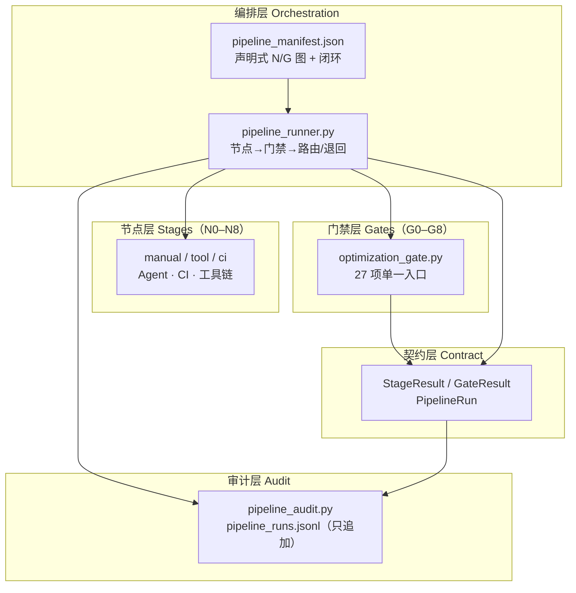

# 报告全流程端到端编排方案与任务清单（REPORT-PIPELINE-IMPL-PLAN v1.2）

> **状态**：已落地（编排器 / 清单 / 留痕均已实现并通过集成审查，见 [pipeline-integration-review](../report-audits/pipeline-integration-review-2026-11-15.md)）
> **用途**：基于 [体系说明 §1.1 全链路主流程图](./report-pipeline-system.md) 给出可运行的端到端编排方案，确保实现与流程图的**节点、流转规则、校验标准 100% 对齐**。
> **对齐声明**：流程图为 **9 个节点 N0–N8 + 9 个门禁 G0–G8**（G8 = 运维 / 告警）。
> **落地载体**：`engine/tools/pipeline_manifest.json`（声明式图）、`engine/tools/pipeline_runner.py`（编排）、`engine/tools/pipeline_audit.py`（审计）、`engine/tests/test_pipeline_runner.py`（一致性测试）。
> **硬性约束**：节点处理 → 门禁校验 → **通过则进入下一节点，不通过则按流程图路径精准退回**；不允许任何流程分支的自定义调整。
> **最后更新**：2026-11-17

---

## 一、整体架构设计

### 1.1 设计目标

1. **流程可执行**：把概念流程图变成可运行、可复现、可审计的编排（manifest → runner）。
2. **门禁单一入口**：所有校验复用 `optimization_gate.py`（27 项），不另写检查命令。
3. **退回精准**：阻断时按 `gate.on_fail` 跳转，并携带上下文（失败检查项 + 输出）。
4. **全链路可追溯**：每个节点 / 门禁 / 路由 / 闭环事件追加留痕。
5. **配置化**：门禁组合、周期、退回目标全部来自 manifest，无硬编码。

### 1.2 分层架构



- **编排层**：唯一负责「顺序与路由」，不含校验逻辑。
- **节点层**：负责「信息加工」，产出交付物；`manual` 由 Agent/人完成，`tool` 由工具链完成，`ci` 由 CI 完成。
- **门禁层**：负责「判定」，复用统一入口，保证同口径。
- **契约层**：负责「数据结构」，是节点与门禁之间的唯一数据形态。
- **审计层**：负责「留痕」，只追加、可回放。

### 1.3 节点职责边界与 N/G 映射

| 节点 | 名称 | driver | 职责边界（不做什么） | 门禁 | 门禁检查项（manifest） | 退回目标 |
|---|---|---|---|---|---|---|
| N0 | 需求与配置 | manual | 只做业务线接入与 business-config，不做内容加工 | G0 | validate_layout, validate, region_topics | N0 |
| N1 | 信息采集 | manual | 只登记 / 采集 / 落盘，不做分级判定 | G1 | source_check, release_calendar, metric_registry | N1 |
| N2 | 信息筛选与分级 | semi | 只做筛选 / 分级 / 双源 / 死链，不做分类归位 | G2 | source_check（--probe） | N2 |
| N3 | 信息分类 | tool | 只做类型 / 维度 / 归位，不做内容生成 | G3 | validate_layout, classify, links | N3 |
| N4 | 内容生成 | manual | 只做内容，不做渲染 | G4 | research_kernel, info_density, fact_card, decision_hub, blind_spot | N4 |
| N5 | 渲染与交付 | tool | 只做 canonical 渲染，不做质量判定 | G5 | page_build, lint, compliance, perf_monitor | N5 |
| N6 | 质量校验与审计 | tool | 只做校验 / 审计，不做生成 | G6 | `*`（全量 27 项）+ 审计四环节 | **N4** |
| N7 | 发布 / 索引 / 归档 | tool | 只做发布留痕，不做校验 | G7 | hub, publish_fingerprint | N7 |
| N8 | 运维与监控 | ci | 只做监控 / 告警，不做内容 | G8 | （外部 CI，无检查项） | N8 |

> **兜底语义**：G1–G5 是**就地门禁**（左移），G6 是**统一门禁收敛 + 审计兜底**。G6 失败按流程图**退回 N4**（而非 N6），因为它暴露的是内容缺陷。

### 1.4 契约层数据结构

```jsonc
// StageResult —— 节点处理结果
{ "id": "N4", "name": "内容生成", "driver": "manual",
  "status": "done | manual | external | error", "detail": "..." }

// GateResult —— 门禁校验结果
{ "id": "G4", "name": "内容四门禁 + 研究内核", "after": "N4",
  "checks": ["research_kernel", "info_density", "fact_card", "decision_hub", "blind_spot"],
  "errors": 0, "warnings": 2, "status": "ok | warn | error | skipped",
  "blocked": false, "on_fail": "N4", "output": [ /* optimization_gate 原始结果 */ ] }

// PipelineRun —— 一次运行
{ "run_id": "a1b2c3d4e5f6", "from_node": "N0", "to_node": "N8",
  "outcome": "passed | blocked", "stages": [], "gates": [],
  "rollback_to": null, "audit_path": "engine/audit/records/pipeline_runs.jsonl" }
```

**字段约束**：`status` 枚举封闭；`blocked = errors > 0`；`on_fail` 必须存在于节点表；`output` 原样保留上游输出（可审计）。

### 1.5 统一数据流转格式

- **载体**：JSON（UTF-8，`ensure_ascii=False`）。
- **流转方向**：`StageResult → GateResult → 路由决策 → 下一 StageResult`，全链路同一形态。
- **上下文携带**：退回时把 `GateResult.output`（失败检查项 + 摘要）作为下一轮 N 节点的输入上下文，保证「精准退回 + 信息不丢」。
- **留痕**：所有结构体经 `pipeline_audit.append()` 写入 JSONL，字段固定、只追加。

### 1.6 核心执行逻辑

```
for node in N0..N8（按 manifest 顺序）:
    stage = 处理(node)          # manual/tool/ci
    留痕(stage)
    gate = gate_after(node)
    if gate 为空: continue
    result = run_gate(gate)     # 复用 optimization_gate
    留痕(result)
    if result.blocked:
        留痕(route: gate.id → gate.on_fail, 携带 output)
        return blocked(rollback_to = gate.on_fail)
return passed
```

闭环：

- **L1（异步）**：N8 完成后，由心跳 / 任务清单 / 复审**异步**触发 N1（不在本次运行内同步执行）。
- **L2（同步）**：G6 阻断时**同步**退回 N4，携带失败上下文。

---

## 二、节点实现规范（N0–N8）

> 每节点统一给出：职责边界 / 输入 / 核心处理逻辑 / 输出 / 交付物质量标准 / 异常处理 / 分支场景。

### N0 需求与配置（业务线接入）
- **职责边界**：注册主题与维度、建目录、撰写 business-config；**不**做内容加工。
- **输入**：业务需求；类型选型结论。
- **核心处理逻辑**：① `layout.json` 注册维度（**维度先后按主题声明**：`economy` 为 `region→category`，其余主题为 `category→region`）；② 建 `{theme}/<维度段...>/{prompts,reports}`（数据落 `data/processed/<theme>/<维度段...>/`）；③ 写 business-config 单一事实源（14 节）；④ 提示词声明继承类型模板；⑤ 首期基线建台账。
- **输出标准**：可被 `iter_business_dirs()` 发现；核心变量齐全；类型引用已注册。
- **异常处理**：维度倒置 / 变量缺失 / 类型未注册 → G0 阻断，退回 N0。
- **分支场景**：新业务线首次接入（全量步骤）；既有业务线变更（跳过期初步骤，仅更新配置）。

### N1 信息采集
- **职责边界**：登记 / 采集 / 落盘；**不**做分级判定。
- **核心处理逻辑**：① 官方一手优先；② 登记 `data/processed/<theme>/<维度段...>/source_registry.json`；③ 消费 `institution_tiers.json`；④ 读指标字典；⑤ 台账运行前读、运行后回写（**只增不改**）；⑥ 发布日历结构化；⑦ 量化数据落盘。
- **输出标准**：报告内每个外部 URL 可匹配登记；关键数字有来源标注；P0 六维度覆盖率 100%；台账只增不改。
- **异常处理**：未登记 URL / 语言违规 / 分级冲突 / 覆盖不足 → G1 阻断，退回 N1。
- **分支场景**：常规采集；触发器触发的事件性采集（并入当月）。

### N2 信息筛选与分级（L0 入口拦截）
- **职责边界**：筛选 / 分级 / 双源 / 死链；**不**做分类归位。
- **核心处理逻辑**：四层分级（官方一手 / 行业机构 / 挂牌门户 / 媒体转述）；R1–R7（登记覆盖 / 邻近判定 / 双源 / 关键数字 / 语言 / 死链 / 机构分级主数据）。
- **输出标准**：`PROXIMITY_WINDOW=240`；`DEAD_STATUS={404,410,451}`；`in_synthesis` 来源 ≥2 被引用。
- **异常处理**：标注不邻近 / 双源不足 / 死链 → G2 阻断，退回 N2；R7 结构性冲突（M3/M4）任何周期阻断。
- **分支场景**：新报告（`--gate-period`）强阻断；历史报告降级 `[W]`。

### N3 信息分类
- **职责边界**：类型 / 维度 / 归位；**不**生成内容。
- **核心处理逻辑**：类型分类（已注册类型）；维度分类；命名识别；`classify_reports.py` 双校验（细分领域段精匹配 + cycle ∈ `TYPE_CADENCE`）。
- **输出标准**：落位唯一、类型与节拍一致、目录深度 = 主题维度数 + 1、region 位置正确。
- **异常处理**：维度倒置 / 归位失败 / 断链 → G3 阻断，退回 N3。
- **分支场景**：常规归位；`--unknown-warn` 未知类型告警。

### N4 内容生成
- **职责边界**：内容；**不**做渲染。
- **核心处理逻辑**：四层提示词继承（优先级：业务提示词 ＞ 类型模板 ＞ 通用基座 ＞ 通用规范）；读上期继承结构 / 口径 / 已核实结论；读台账活值（禁硬编码）；无触发降级为核验 / 收敛型；写已修正事实清单（只追加）；`[FC-…]` 先登记再引用；量化模型契约输出。
- **输出标准**：类型模板节数与顺序；决策摘要 ≤1 屏；新增信息模块四要素；信息等级四级标注。
- **异常处理**：结构缺节 / 内核缺失 / 分层 / 卡片 / 决策缺项 → G4 阻断，退回 N4；量化模型失败显式上报（禁留白 / 静默降级）。
- **分支场景**：首期基线；定期月 / 季 / 年；事件触发轻运行；复核退回重生成。

### N5 渲染与交付
- **职责边界**：canonical 渲染；**不**做质量判定。
- **核心处理逻辑**：md → HTML（`md2html.py`）或手写；套 canonical 样式；骨架 `header.report-head` + `nav.report-nav` + `main.wrap`；表格 `class="fixed"` + 列宽；来源链接两种承载；自包含。
- **输出标准**：无外部数据文件；A11y 强制项齐全；断点 720 / 960 / 560；打印样式；体积 hub ≤100KB / 报告 ≤1.5MB。
- **异常处理**：漂移色 / 骨架缺失 / 断头锚点 / 节数不符 → G5 阻断，退回 N5。
- **分支场景**：md 源渲染；既有 HTML restyle；ECharts 页。

### N6 质量校验与审计
- **职责边界**：校验 / 审计；**不**生成内容。
- **核心处理逻辑**：G6 统一门禁（27 项）+ 审计四环节（L1/L2/L3 + A1–A8）+ 语义增量 + 性能。
- **输出标准**：0 `[E]`；审计覆盖 12/12；标识与 registry 一致。
- **异常处理**：任一 `[E]` → G6 阻断，**退回 N4**；审计 fail-fast。
- **分支场景**：常规终审；L3 宽限期内（14 天）告警不阻断。

### N7 发布 / 索引 / 归档
- **职责边界**：发布留痕；**不**做校验。
- **核心处理逻辑**：`build_hub.py`（`--check` 确定性）；`build_index.py` 心跳；`archive_reports.py` 滚动归档；`publish_fingerprint.py --emit`；`sync_vocab.py` 词汇同步。
- **输出标准**：生成物确定性（无时间戳）；`--check` 过期即阻断；归档幂等。
- **异常处理**：产物过期 / 重复内容 → G7 阻断，退回 N7。
- **分支场景**：首次发布；增量发布；归档满额滚动。

### N8 运维与监控
- **职责边界**：监控 / 告警；**不**做内容。
- **核心处理逻辑**：CI 工作流（ci / html-sync / content-update / scheduled-maintenance / audit）+ `webhook-alert.yml` + `automation_status.py` + `update_planner.py`。
- **输出标准**：失败即 Issue；并发组 `auto-commit-main`；无变更不提交。
- **异常处理**：失败告警（G8 外部，不自动阻断内容流）。
- **分支场景**：定时维护；事件触发；心跳复审。

---

## 三、门禁校验规则（G0–G8）

> 所有门禁**配置化**：检查项、周期、退回目标来自 `pipeline_manifest.json`；runner 只做调度，不内嵌规则。

### G0 配置校验（N0 → N0）
维度顺序（按主题声明）、变量齐全、类型注册、提示词继承，任一 `[E]` 即阻断。

### G1 来源登记校验（N1 → N1）
R1 登记覆盖 / R2 分级合规 / R3 双源 / R4 关键数字 / R5 语言规则 / R7 机构分级 + 发布日历 P0 覆盖率 100% + 指标登记必填字段。阻断触发：上述任一 `[E]`（`--source-gate-period` 默认 2027-01）。

### G2 分级 / 双源 / 死链校验（N2 → N2）
R2 / R3 复核 + R6 死链（404 / 410 / 451 = 死链；403 / 429 / 5xx / 超时 = 不可达）。阻断触发：明确死链 `[E]`（`--probe --probe-lenient`）。

### G3 分类 / 归位 / 断链校验（N3 → N3）
维度顺序 + 归位双校验（细分领域段精匹配 + cycle 白名单）+ 无断头锚点。阻断触发：任一 `[E]`。

### G4 内容四门禁 + 研究内核（N4 → N4）
| 门禁 | 规则 | 级别 |
|---|---|---|
| research_kernel | 周期定位 / 传导量化 / 政策入模 / 盲区列示 | 新 E / 历史 W |
| info_density | ID-01–08、DC-05（分层 / 摘要 ≤1 屏 / 等级 / 新增模块 / 指针） | 新 E / 历史 W |
| fact_card | FC-01–03（结构 / 引用可解析 / 共享域覆盖） | 新 E / 历史 W |
| decision_hub | DC-01–04（决策卡五字段 / 行动协议 / 场景切片 / ex-ante） | 新 E / 历史 W |
| blind_spot | BS-01–05（九字段 / 状态 / 责任周期 / P0 四类 / 消号） | E（BS-05 W） |

阻断触发：任一 `[E]`（`--gate-period` 默认 2026-12）。

### G5 页面 / 合规 / 性能校验（N5 → N5）
page_build（P01–P15）/ lint（W）/ compliance（节数 / `id="sN"` / 断头锚点 / 导航）/ perf_monitor（全量 P95 ≤60s；单报告 avg ≤2s；错误率 0）。阻断触发：任一 `[E]`。

### G6 统一门禁 + 审计（N6 → **N4**）
检查项 `*`（全量 27 项，含 `--probe`）+ 审计 L1/L2/L3 + 终审 A1–A8；退出码 0 通过 / 1 有 `[E]` / 2 仅 `[W]`；两级周期（内容 2026-12、来源 2027-01）。阻断触发：任一 `[E]` 或审计 fail-fast，**退回 N4**，携带 `GateResult.output`。

### G7 产物确定性校验（N7 → N7）
`build_hub.py --check` 比对通过（E）；sha256 无漂移 / 无重复内容（E / W）。阻断触发：`--check` 过期或指纹漂移。

### G8 运维 / 告警校验（N8 → N8）
外部 CI 无自动检查项，由 CI 工作流 + `webhook-alert.yml` 承载；失败即 Issue（不阻断内容流）。

### 3.9 配置化与无硬编码
- 门禁组合 / 周期 / 退回目标 = `pipeline_manifest.json` 字段；runner 无内嵌规则。
- 新增门禁：只需在 `optimization_gate.CHECKS` 注册 + manifest 引用，runner 自动生效（有测试锁定子集关系）。
- 两级 gate-period 与退出码口径由 `optimization_gate` 统一提供，runner 只透传。

---

## 四、闭环链路实现

### 4.1 L1：N8 → N1（异步）
心跳（`automation_status.py`）/ 任务清单（`update_planner.py`）/ 定期复审触发；manifest `loops[L1] = {from: N8, to: N1, mode: async, triggers: [...]}`；runner 渲染并留痕，不改变主链顺序。

### 4.2 L2：G6 → N4（同步，E 阻断）
`run_pipeline` 检测 `blocked` 后写入 `route` 审计并返回 `rollback_to=N4`；由调用方从 N4 重跑（`--from N4`）。携带 `GateResult.output`（失败检查项 + 摘要）+ `on_fail`。

---

## 五、任务实施清单（已完成）

> T0 = 2026-11-15。截至 2026-11-16，M0–M5 全部交付，`pipeline_runner validate` 通过（9 节点 / 9 门禁 / 2 闭环），全链路真实运行 `outcome=passed`。

| 里程碑 | 日期 | 交付 | 状态 |
|---|---|---|---|
| M0 方案冻结 | 11-15 | 本方案 + manifest / runner / audit 落地，单测通过 | ✅ |
| M1 编排贯通 | 11-21 | `pipeline_runner validate` / `plan` / `gate Gx` 可用 | ✅（提前） |
| M2 门禁全接 | 11-28 | 每个 G 均可经 runner 触发，退回路径正确 | ✅（提前） |
| M3 闭环验证 | 12-05 | G6→N4 退回、N8→N1 异步触发有测试与留痕 | ✅（提前） |
| M4 审计上线 | 12-12 | `pipeline_runs.jsonl` 可回放，CI 接入 | ✅（提前） |
| M5 全场景验收 | 01-02 | 正常 / 异常 / 闭环全场景测试通过 | ✅（提前） |

**关键任务与交付物**：

| # | 任务 | 交付物 | 验收标准 |
|---|---|---|---|
| T0-1 | 冻结流程图与 N/G 契约 | 本方案 §1 | 9 节点 / 9 门禁对齐 |
| T0-2 | 编写 manifest | `pipeline_manifest.json` | `validate` 通过；L1/L2 精确 |
| T0-3 | 实现 runner | `pipeline_runner.py` | 路由 / 退回单测通过 |
| T0-4 | 实现审计 | `pipeline_audit.py` + JSONL | 只追加 / 可回放 |
| T0-5 | 一致性测试 | `test_pipeline_runner.py` | 16 项通过 |
| T1-1/T1-2 | G0–G5 接入 | runner 门禁调度 | 退回 N0–N5 正确 |
| T2-1/T2-2 | G6 全量 + 审计；G7 / G8 接入 | G6 = 27 项 + 审计；产物 / 运维守卫 | 退回 N4 / N7；G8 外部 |
| T3-1/T3-2 | L2 / L1 闭环 | `route` 留痕 + 上下文；manifest loops + 心跳登记 | 断言 rollback=N4 |
| T4-1/T4-2 | 审计 CI 接入；埋点规范 | ci.yml / 维护步骤；日志字段标准 | 运行留痕可查 |
| T5-1 | 全场景验证 | 验证报告 | 正常 / 异常 / 闭环覆盖 |

---

## 六、质量与保障要求

### 6.1 日志埋点规范
- **字段固定**：`schema_version / ts / run_id / kind / ...`；`kind ∈ {run_start, stage, gate, route, loop, run_end}`。
- **三级粒度**：运行级（run_start/end）、节点级（stage）、门禁级（gate/route）。
- **性能埋点**：每门禁 `duration_ms`（经 `perf_monitor` 汇总），P95 ≤60s。

### 6.2 审计追溯机制
- **只追加**：`pipeline_runs.jsonl` 不覆盖、不修改。
- **可回放**：`pipeline_audit.read_run(run_id)` 还原时序链路。
- **与审计四环节衔接**：G6 的审计记录写入 `engine/audit/records/reviews/`，标识三态（none / pre / full）。

### 6.3 分级异常告警

| 级别 | 触发 | 动作 |
|---|---|---|
| P0 | G6 `[E]` / 审计 fail-fast / 死链 | 阻断 + 退回 N4 + 立即告警 |
| P1 | G1–G5 `[E]` | 阻断 + 退回本阶段 + 告警 |
| P2 | `[W]`（历史降级 / 性能 / 指纹漂移） | 放行 + 警告 Issue |
| 运维 | CI 失败 | `webhook-alert.yml` → Issue |

- **告警链路**：失败 → `automation-failure`；连续两次超阈值 → `performance` Issue。

---

## 版本记录

| 版本 | 日期 | 变更 | 说明 |
|---|---|---|---|
| v1.0 | 2026-11-15 | 初始版本 | 端到端方案（架构 / 节点规范 / 门禁规则 / 闭环 / 任务清单 / 保障）；配套 manifest + runner + audit + 测试 |
| v1.1 | 2026-11-16 | 状态与精简 | 状态改为「已落地」；任务清单由日期计划改为交付状态表；合并重复门禁规则表；补充集成审查指针 |
| v1.2 | 2026-11-17 | 维度口径对齐 | N0 / N3 维度分类与归位双校验改为按 `layout.json` 主题声明顺序；`property_type` 表述改为细分领域段 |
