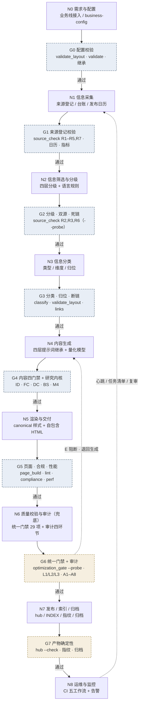
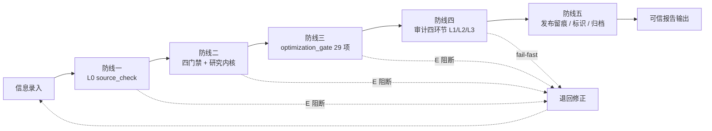
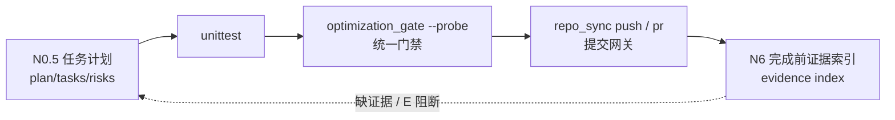
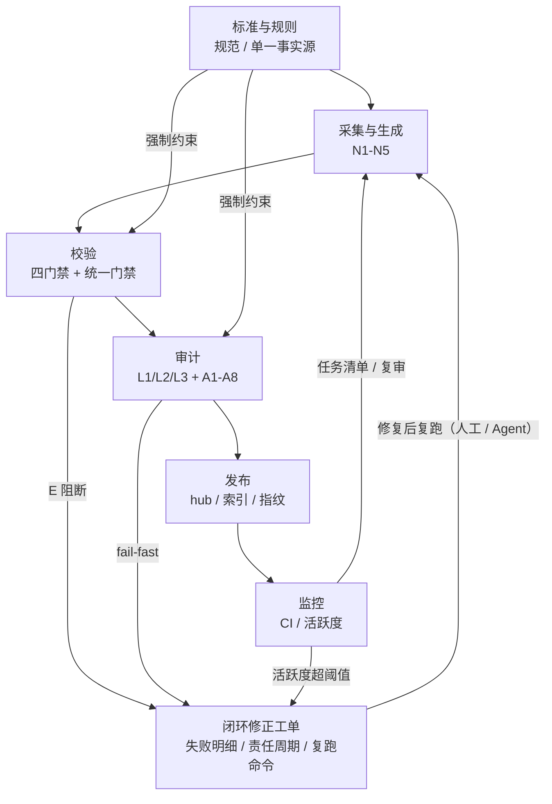

# 报告全链路信息处理体系（REPORT-PIPELINE-SYSTEM v1.2）

> **状态**：现行规范
> **用途**：把 tech-context-digest 从「信息录入 → 校验 → 更新 → 生成 → 发布」的全链路节点、质量保障流水线、联动闭环固化为**唯一体系说明**，供人工与 Agent 共同遵循。
> **事实源**：本文件是体系层说明；各环节规则正文以专用规范为准——[通用基座](../templates/prompt-generic-base.md)、[监测报告通用规范](../templates/monitoring-common-spec.md)、[信息分层规范](../templates/information-layering-spec.md)、[决策交付规范](../templates/decision-delivery-spec.md)、[页面构建规范](./page-build-spec.md)、[页面构建治理](./page-build-governance.md)、[流程复用清单](./report-process-reuse.md)、[多会话 Git 协议](./multi-session-git-protocol.md)。
> **适用**：全部业务线报告（基线 / 月 / 季 / 年 / 周报）、决策仪表盘、hub 页（`index.html` / `reader.html`）与未来新增主题。
> **硬性约束**：本文件与 `AGENTS.md` 同级生效；环节规则冲突时以专用规范与代码事实源为准，并回写本文件。
> **最后更新**：2026-11-17

---

## 一、体系总览：一条主链 + 五道防线

整个体系 = **一条信息主链（N0–N8 九个节点）** × **五道防线（入口拦截 / 四门禁 / 统一门禁 / 审计四环节 / 发布留痕）**，并以「单一事实源 + 指针引用 + 两级 gate-period」为贯穿纪律。

**门禁左移（shift-left）**：五道防线不是末端集中的一道关，而是**按阶段左移分布**——N0–N5 每个生产阶段出口都配一道就地门禁（G0–G5），信息在进入下一阶段前被拦截；N6 只承担「统一门禁收敛 + 审计兜底」，N7–N8 保留产物与运维守卫。原则与梯度见 §1.3。

**五道防线**（左移分布，非末端集中）：

1. **L0 入口拦截**：`source_check.py`（R1–R8），生成前把关来源登记 / 分级 / 双源 / 死链 / 登记字段。
2. **内容四门禁**：信息分层（ID）/ 事实卡片（FC）/ 决策交付（DC）/ 盲区台账（BS），外加研究内核（M4）。
3. **统一门禁**：`optimization_gate.py`（29 项单一入口），CI / 提交 / 审计共用同口径。
4. **审计四环节**：生成 → 初审 → 复核 → 终审（L1 / L2 / L3 + A1–A8），标识三态 + 宽限期。
5. **发布留痕**：指纹（sha256）/ 归档 / 索引心跳 / 词汇同步 / `pre-push` 守卫。

### 1.1 全链路主流程图

- 蓝色虚线 = **左移就地门禁（G0–G5）**：生产阶段出口拦截，失败走短回路退回本阶段。
- 黄色虚线 = **兜底 / 出口门禁（G6–G8）**：统一门禁收敛、审计、产物与运维守卫。

### 1.2 五道防线纵深图

### 1.3 门禁左移原则

**问题**：门禁若只集中在 N6（出口后置），错误在信息生成后才暴露，返工成本高、反馈回路长；「出口可信」也不等于「过程可信」。

**原则**：**每阶段就地拦截 + 统一入口收敛 + 出口审计兜底**。信息每进入下一阶段前，先过本阶段的就地门禁；就地门禁失败走**短回路**退回本阶段修正，不流入下游。

**三层门禁梯度**：

| 层 | 门禁 | 位置 | 作用 | 失败回路 |
|---|---|---|---|---|
| ① 就地门禁 | G0–G5 | N0–N5 各阶段出口 | 生产时拦截：配置 / 来源 / 分级 / 分类 / 内容 / 页面 | 短回路退回本阶段 |
| ② 统一门禁 | G6 | N6 | 29 项单一入口收敛同口径，防漏检 | 长回路退回生成 |
| ③ 出口审计 | 审计四环节 | N6 | L1 / L2 / L3 + A1–A8，语义与终审 | fail-fast 退回 |

**纪律**：

- 就地门禁是「生产的一部分」，不是事后补救；提示词 / 模板层同步内嵌自检清单（通用基座第九节日检）。
- 统一门禁不替代就地门禁，只做收敛与兜底；两级 gate-period 保证历史报告不追溯阻断（见 §5.2）。
- 门禁在落盘后异步执行，不阻塞生成（性能见 `perf_monitor`）。

### 1.4 任务级闭环（N0.5，适配 mainline）

在 N0 之后新增 **N0.5「任务计划」子节点**，吸收 mainline 阶段 2 / 5 / 11 的三项增量机制（计划工件 / 本地 mainline 编排 / 完成前证据索引），**不改动 N0–N8 主链与 G0–G8 门禁**。任务工件落 `engine/audit/records/` 下的 `tasks/<slug>/`，由 `task_plan.py` 生成、`local_mainline.py` 编排、`repo_sync.py` 提交；无任务计划四件套（`plan.json` / `tasks.json` / `risks.json` / `task-start.md`）不得 `repo_sync run --gate`。

---

## 二、全链路节点拆解（N0–N8）

### N0 需求与配置（业务线接入）

| 项 | 内容 |
|---|---|
| 输入 | 业务需求；类型选型结论（[report-classification](../templates/report-classification.md) 六族十二类） |
| 核心步骤 | ① 在 `engine/tools/layout.json` 注册主题与维度序列（**维度先后按主题声明**：`economy` 为 `region→category`，其余主题为 `category→region`）；② 建 `{theme}/<维度段...>/`（`prompts/` `reports/`；数据落 `data/processed/<theme>/<维度段...>/`）；③ 撰写 `prompts/business-config.md` 单一事实源；④ 周期提示词头部声明继承 `engine/templates/<类型ID>/`；⑤ 首期跑基线提示词，建立台账与基线锚 |
| 输出标准 | 可被 `_common.iter_business_dirs()` 发现；核心变量齐全；类型引用已注册 |
| 工具 | `validate_layout.py`（`check_dimension_priority()`）、`validate.py`、`ensure_region_topics.py`、`_common.py`、`test_prompt_inheritance.py` |

`business-config.md` 是**业务单一事实源**，含 14 节：运行变量固定值、受众、术语口径、来源优先级（四级 + P0–P5 + 获取路径 + 最小可替代集）、信号阈值 K01–K15、结构红线 RL-01–RL-09、重大事件触发器、先行信号矩阵、专题预警、政策框架 G01–G05、口径冲突并列、渲染差异实例化、信息分层强制项、版本记录。

#### N0.5 任务计划（mainline 阶段 2 吸收，任务级闭环层）

| 项 | 内容 |
|---|---|
| 输入 | 任务需求 / 验收标准 / 分支 slug |
| 核心步骤 | ① `task_plan.py init --report <rel>...` 生成 `plan.json`（含 `reports` 关联）/ `tasks.json` / `risks.json` / `task-start.md`（落 `engine/audit/records/` 下的 `tasks/<slug>/`）；② 声明与 N0–N8 的映射与复用入口 |
| 输出标准 | 工件 schema 固定、确定性可重放（`task_plan.py check`）；受管 `task/*` 分支无任务计划四件套不得 `repo_sync run --gate` |
| 工具 | `task_plan.py`、`local_mainline.py`（薄封装，只编排）、`repo_sync.py`（提交网关） |
| 门禁 | 复用统一门禁 `optimization_gate.py --probe`；不另写校验 |

### N1 信息采集

| 项 | 内容 |
|---|---|
| 输入 | business-config 的来源优先级、发布日历、触发器清单 |
| 核心步骤 | ① 官方一手优先采集；② 登记 `data/processed/<theme>/<维度段...>/source_registry.json`（`source_id` / `tier` / `publisher` / `url` / `lang` / `verify_status` / `updated` / `in_synthesis`）；③ 消费机构分级主数据 `institution_tiers.json`；④ 指标字典 `metrics-dictionary.json`；⑤ 台账运行前读、运行后回写（增量另存，不覆盖历史）；⑥ 发布日历结构化；⑦ 量化数据落盘（供 N1–N8 模型） |
| 输出标准 | 报告内每个外部 URL 可匹配登记；关键数字有来源标注；P0 六维度来源覆盖率 100%；台账只增不改 |
| 工具 | `source_check.py`、`release_calendar.py`、`metric_registry.py`、`_quant.py` 与 N1–N8 量化模型 |

### N2 信息筛选与分级（L0 入口拦截）

| 项 | 内容 |
|---|---|
| 输入 | 报告 HTML + 业务线来源登记 + business-config 语言规则 |
| 核心规则 | **四层分级**：① 官方一手（可直接采信）② 行业机构（PDF 须记日期页码）③ 挂牌门户（仅卖方预期 / 情绪）④ 媒体转述（须标「需核实原文」）；**R1–R8**：登记覆盖 / 分级邻近 / 双源确认 / 关键数字来源 / 语言规则 / 死链 / 机构分级主数据一致性 / 登记字段（verify_status ∈ verified·media_unverified·unverifiable，updated = YYYY-MM-DD） |
| 阈值 | `PROXIMITY_WINDOW=240` 字符；`DEAD_STATUS={404,410,451}`；`in_synthesis` 来源 ≥2 被引用；`official_en` 违规 = E、`en_or_zh` 集外 = W |
| 拦截 | 新报告（周期 ≥ source-gate-period）缺项 = `[E]` 阻断；历史报告降级 `[W]`；R7 的 M3 / M4 结构性冲突不降级 |
| 工具 | `source_check.py`（`--probe` 并发 8 线程 / 3s 超时；CI 用 `--probe-lenient`） |

### N3 信息分类

| 项 | 内容 |
|---|---|
| 输入 | 报告文件、业务线目录、类型注册表 |
| 核心步骤 | ① 类型分类（已注册类型，选型参考六族十二类）；② 维度分类（按 `layout.json` 主题维度序列：`economy` 为 `theme/region/category`，其余主题为 `theme/category/region`）；③ 命名识别（`monthly` / `quarterly` / `annual` / `baseline` / `weekly`）；④ 报告归位 `classify_reports.py` **双校验**（细分领域段精匹配 + cycle ∈ `TYPE_CADENCE` 白名单） |
| 输出标准 | 报告落位唯一、类型与节拍一致、目录深度 = 主题维度数 + 1、region 段位置正确 |
| 工具 | `_common.py`、`classify_reports.py`、`validate_layout.py`、`test_classification_mapping.py` |

### N4 内容生成

| 项 | 内容 |
|---|---|
| 输入 | 通用基座 + 通用规范 + 类型模板 + business-config + 上期 / 基线报告 + 台账 |
| 继承体系 | **四层**：业务提示词 = 通用基座 × 通用规范 × 类型模板 × business-config；冲突优先级 **业务提示词 ＞ 类型模板 ＞ 通用基座 ＞ 通用规范** |
| 核心步骤 | ① 读上期与基线，继承结构 / 口径裁决 / 已核实结论；② 读台账活值（模板内严禁硬编码活值）；③ 触发器判定，**无触发降级为核验 / 收敛型轻运行，不得虚构变化**；④ 写「已修正事实清单」（只追加、不回退）；⑤ 事实卡片 `[FC-…]` 引用（先登记再入报告）；⑥ 量化模型按契约输出（参数区间 + 假设；失败显式上报，禁止留白 / 静默降级）；⑦ 回写台账与变更摘要 |
| 结构标准 | 类型模板规定节数与顺序；决策摘要 ≤1 屏；新增信息模块四要素；信息等级四级标注 |
| 工具 | 提示词文件、通用基座第九节日检清单、`metric_registry.py`、`threshold_calibration.py` |

### N5 渲染与交付

| 项 | 内容 |
|---|---|
| 输入 | md 源 或 手写 HTML 骨架 |
| 核心步骤 | ① md → HTML（`md2html.py`）或手写；② 套用 canonical 样式（`report_style.py::CANONICAL_CSS` / `TOKENS`）；③ 骨架 `header.report-head` + `nav.report-nav`（`.nav-url` + `.nav-tabs` 与 `h2.sec#sN` 逐字对应）+ `main.wrap`；④ 表格 `class="fixed"` + 列宽；⑤ 来源链接两种承载（`.src-head/.src-pop` 弹层 或 行内链接 `↗`）；⑥ 自包含（CSS/JS 内联，ECharts CDN 白名单） |
| 输出标准 | 无外部数据文件；A11y 强制项齐全；断点 720 / 960 / 560；打印样式；体积 hub ≤100KB / 报告 ≤1.5MB |
| 工具 | `md2html.py`、`report_style.py`、`restyle_reports.py`、[监测报告通用规范](../templates/monitoring-common-spec.md)、[页面构建规范](./page-build-spec.md) |

### N6 质量校验与审计

详见 §三。核心：四门禁 + 研究内核 + 统一门禁 29 项 + 审计四环节 + quality 修复 + 语义增量 + 性能 + 合规 + 页面。

### N7 发布 / 索引 / 归档

| 项 | 内容 |
|---|---|
| 核心步骤 | ① `build_hub.py` 生成 `index.html` / `reader.html`（`--check` 比对确定性）；② `build_index.py` 生成 `INDEX.md`（心跳）；③ `archive_reports.py` 滚动归档 `reports/` 与 `sources/`（monthly 18 / quarterly 8 / annual 5 / baseline 3 / weekly 12，与展示窗口同源，见 [report-cycle-windows.md](report-cycle-windows.md)）；④ `publish_fingerprint.py --emit` 采集 sha256；⑤ 词汇库 `sync_vocab.py` 标记区间增量同步（逐词条 sha256、原子写、失败回滚） |
| 输出标准 | 生成物确定性（无时间戳）；`--check` 过期即阻断；归档幂等 |
| 工具 | `build_hub.py`、`build_index.py`、`archive_reports.py`、`publish_fingerprint.py`、`sync_vocab.py` |

### N8 运维与监控（CI 五工作流）

| 工作流 | 触发 | 关键动作 | 阻断 |
|---|---|---|---|
| `ci.yml` | push / PR | `py_compile` → `unittest` → **统一门禁 `--probe`** → commit status | `[E]` 阻断 |
| `html-sync.yml` | 报告 / 生成器变更 | `md2html` + `build_hub` + 指纹 → 统一门禁 → `submit-pr` | `[E]` 阻断 |
| `content-update.yml` | 每月 1 日 / 季首月 / dispatch | 归位 → 维护流水线 → 统一门禁 → 任务清单 Issue → `submit-pr` | `[E]` 阻断 |
| `scheduled-maintenance.yml` | 每周一 02:30 UTC | 结构补全 → 归位 → 维护流水线 → 统一门禁 → 合规审计 → 单测 → 性能 → 活跃度 → `submit-pr` | `[E]` 阻断 |
| `audit.yml` | 报告变更 | `audit_tool run --strict`（四环节 fail-fast）+ `accept` + `submit-pr` | `[E]` 或超 L3 宽限 |
| `webhook-alert.yml` | 上述失败 | 建 Issue / webhook | — |

并发纪律：四个自动提交工作流共用 `concurrency: auto-commit-main`；提交与推送分离；无变更不提交。多会话 Git 协议见[专文](./multi-session-git-protocol.md)。

---

## 三、五道防线：质量保障机制

### 3.1 防线一：L0 入口拦截（`source_check.py`）

| 规则 | 判定 | 级别（新报告 / 历史） |
|---|---|---|
| R1 登记覆盖 | 报告内全部外部 URL 必须能在来源登记匹配；业务配置声明 `{{SOURCE_STRATEGY}} = synthesis_only` 的综合层（无外部来源）豁免「登记为空」告警，但一旦出现外部 URL 仍须登记 | E / W |
| R2 分级合规 | tier=4 须邻近「需核实原文」（窗口 240 字符）；tier=3 须标「卖方预期 / 情绪 / 参考」 | E / W（tier3 恒 W） |
| R3 双源确认 | `in_synthesis` 来源须 ≥2 个被报告引用 | E / W |
| R4 关键数字 | 含单位 / 量级数字的正文断言块（`li`/`p`）附近 `PROXIMITY_WINDOW`（240 字符）内须有来源标记（`[FC-…]` / `[S-nnn]` / `[Source:` / 来源标签 / 外链 / `K` 指针 / 核验等级标 / 含年份机构引用）；已声明信息（自算 / 推断 / 假设 / 待核）、说明性段落与咨询容器 / 咨询章节内块不计 | E / W |
| R5 语言规则 | tier1/2 来源语言须符合业务配置（token 化分级） | E / W |
| R6 死链 | 404 / 410 / 451 = 死链；403 / 429 / 5xx / 超时 = 网络不可达 | E / W（历史降级） |
| R7 机构分级 | 与 `institution_tiers.json` / business-config 一致性（M1–M5） | 结构性 M3 / M4 恒 E |
| R8 登记字段 | `verify_status` ∈ verified / media_unverified / unverifiable；含 `updated`（YYYY-MM-DD） | W（数据卫生） |

### 3.2 防线二：内容四门禁 + 研究内核

| 门禁 | 规则 | 级别 |
|---|---|---|
| **info_density**（ID-01–08、DC-05） | 分层结构 / 决策摘要 ≤1 屏 / 信息等级四级 / 摘要引用约束 / 新增信息模块 / 指针引用 / 事实卡片 / 场景切片 / 读数时点 | 新 E / 历史 W（ID-02、ID-06 恒 W） |
| **fact_card**（FC-01–03） | 卡片结构 / 引用可解析 / 共享域覆盖 | 新 E / 历史 W |
| **decision_hub**（DC-01–04） | 决策卡五字段 / 行动协议五要素 + 三档 / 场景切片 / ex-ante | 新 E / 历史 W |
| **blind_spot**（BS-01–05） | 九字段 / 状态 / 责任周期 / P0 四类（就业、收入、空置、竣工）/ 消号条件 | E（BS-05 为 W） |
| **vocab_drift**（VD-01–03） | 同步区块成对 / 已注册主题词库非空 / 提示词规范形与词库一致 | VD-01 E；VD-02/03 W |
| **research_kernel**（M4） | 周期定位 / 传导量化 / 政策入模 / 盲区列示 | 新 E / 历史 W |
| **monitoring_render**（MON-01–05） | 图注齐备 / 口径并列须注明不可相减 / 列宽塌缩 / noopener / 原生 title | W（存量不阻断，新报告评 E） |
| **consistency**（LC-01–02 / VG-01–02） | md-ledger 结构 / 看板指标名在最新报告出现 / 周期报告读数时点 / 语义版本修正留痕 | W |
| **naming**（NC-01–02） | 目录 kebab-case（含 Python 包 snake 白名单）/ 按位置文件命名规则矩阵 | W |
| **prompt_consistency**（PC-01–03） | 类型注册表与实际业务线一致 / business-config 不复述规范 / 周期提示词齐备 | W |
| **model_contract**（MC-01–05） | 参数区间 / 假设留痕 / 失败上报（DC-07 提升为门禁） | W |

### 3.3 防线三：统一门禁（`optimization_gate.py`，29 项单一入口）

| 项 | 内容 |
|---|---|
| 清单（29） | validate、validate_layout、lint、compliance、classify、region_topics、links、hub、page_build、source_check、metric_registry、metric_audit、release_calendar、publish_fingerprint、semantic_diff、perf_monitor、research_kernel、info_density、fact_card、decision_hub、blind_spot、vocab_drift、ruff、mypy、monitoring_render、consistency、naming、prompt_consistency、model_contract |
| 退出码 | 0 通过；1 有 `[E]`（阻断）；2 仅 `[W]`（放行） |
| warn_ok | 多数检查容忍 exit 2；`links` / `hub` / `metric_registry` 不容忍；`ruff` / `mypy` 默认容忍（Phase 3.1，稳定后评 `[E]`） |
| `--probe` | 给 `source_check` 追加 `--probe --probe-lenient`（明确死链在 R6 阻断期内阻断，环境性不可达仅告警） |
| **两级 gate-period** | 内容门禁（research_kernel / info_density / fact_card / decision_hub）用 `--gate-period`；来源登记门禁（source_check）用 `--source-gate-period`；**两级默认均为 `auto`（滚动基线 = 当前自然月 + 1）**，见 §5.2 |
| 复用矩阵 | 本地 `repo_sync run --gate`；`ci.yml` / `html-sync.yml` / `content-update.yml` / `scheduled-maintenance.yml` 步骤调用；`audit_tool._run_gate()` 内部调用 |
| 一致性强制 | `test_process_gates.py::TestOptimizationGateReuse`：四门禁必须出现在 `CHECKS`；四工作流必须调用统一入口且不得分项重复；`audit.yml` 必须 `run --strict` |

### 3.4 防线四：审计四环节（`engine/audit/`）

| 环节 | 判定 | 级别 |
|---|---|---|
| L1 机器 | 既有工具链 0 错误 | 0 错误才过 |
| L2 结构 | 十大要素 E1–E10 + 硬性项 H1–H3 | 审计 10/10、业务 ≥9/10 |
| L3 语义 | Agent 逐项写证据（准确性 ≥99%、可追溯 ≥95%、跨章节一致 ≥99%、结论-证据 ≥95%） | Agent 记录为权威 |
| 终审 A1–A8 | L1=0 / 结构达标 / 覆盖 ≥95% / 已审计率 ≥99% / 可追溯 ≥95% / 无绝对化与裸单位 / 四环节齐备 / 标识一致 | 全过才置 `audited` |

- **标识三态**：`none` / `pre`（机器终审过、L3 未完成，灰）/ `full`（navy）。
- **宽限期**：`L3_GRACE_DAYS=14`；宽限内缺语义终审只告警（退出码 2），超期或 `machine_final` 失败才 fail-fast（退出码 1）。
- **L3 SLA**：语义终审由 Agent 定期执行，**每两周覆盖全部有效正式报告**；与 14 天宽限期一致，超期未审由维护流水线告警（`audit_tool.py l3-status`，接入 `scheduled-maintenance.yml`，超期 `[W]` 不阻断）。
- **P0-2**：语义环节以 Agent 记录为权威，ci-bot 不得覆盖。
- **留痕**：`records/reviews/<slug>.json` 只追加；`records/audit_registry.json` 状态机 `draft → in-review → audited / rejected`。

### 3.5 防线五与其他确定性防线

| 防线 | 规则 / 阈值 |
|---|---|
| `page_build_check.py` | P01–P15：lang/viewport/charset、canonical 主色 `--navy:#16324f`、无漂移色、skip-link、焦点环、`prefers-reduced-motion`、`@media print`、表格配平、报告骨架、`h2.sec` 锚点、`.chart-eh`、无时间戳 = E；`.nav-url`、体积、`img[alt]` = W |
| `compliance_check.py` | 按 `compliance-rules.json`：节数不足 = E、超出 = W；`id="sN"` 有序；断头锚点 = E；月/季/年/周缺导航 = E；`--audit` 出报告不阻断 |
| `metric_registry.py` | 必填 7 字段；别名唯一；阈值正则；去重键 `(date, indicator_id, caliber)`；无实测值走结构兜底 |
| `release_calendar.py` | P0 六维度覆盖率 100% |
| `publish_fingerprint.py` | sha256 字节指纹；漂移与重复内容检测 |
| `semantic_diff.py` + `semantic_checks/` | 块级 diff，仅变更块跑插件：无来源数字 P0 / 同指标多值 P0 / 推断无依据 P1 / 多单位无口径 P1 |
| `perf_monitor.py` | 全量 P95 > 60s = P0；单报告 avg > 2s = P1；错误率 > 0 = P0 |
| `quality/`（QUALITY-AUDIT v1.0） | rubric 四维 21 指标；P0=0 且健康度 ≥90% = pass；chaos 15 类 → SOP-01–15；七阶段修复 |
| Git 守卫 | `repo_sync.py` 锁 + `fetch --rebase` + 直推 main 拒绝；pre-push 按 refspec 判定；main 分支保护 |

---

## 四、闭环联动关系

### 4.1 阶段 × 防线矩阵

| 阶段 | 就地门禁 | 主要防线 | 拦截点 |
|---|---|---|---|
| N0 配置 | **G0** | `validate_layout` / `validate` / `test_prompt_inheritance` | region 倒置、变量缺失、类型未注册 |
| N1 采集 | **G1** | `source_check`（R1–R5、R7）/ `release_calendar` / `metric_registry` | 未登记 URL、语言违规、分级冲突、P0 覆盖不足 |
| N2 筛选 | **G2** | `source_check`（R2 / R3 / R6）+ `--probe` | 标注不邻近、双源不足、死链 |
| N3 分类 | **G3** | `validate_layout` / `classify` / `check_links` | 维度倒置、归位失败、断链 |
| N4 生成 | **G4** | 提示词自检 + `research_kernel` + 四门禁（内容侧） | 结构缺节、内核缺失、分层 / 卡片 / 决策缺项 |
| N5 渲染 | **G5** | `page_build_check` / `lint_reports` / `compliance_check` | 漂移色、骨架缺失、断头锚点、节数不符 |
| N6 校验 | **G6（兜底）** | **统一门禁 29 项** + 审计四环节 + `quality` | 任一 `[E]`；审计 fail-fast |
| N7 发布 | **G7** | `build_hub --check` / 指纹 / 归档 | 产物过期、重复内容 |
| N8 运维 | **G8** | CI 工作流 + 告警 + 活跃度 | 失败即 Issue |

### 4.2 闭环联动图

### 4.3 四层收敛（闭环逻辑）

1. **单点收敛**：全部确定性检查收敛到 `optimization_gate.py` 一个入口，五阶段 + 审计共用同口径；一致性由单测强制。
2. **事实收敛**：事实唯一定义于台账 / 登记册 / 事实卡片（`[FC-…]`）/ 决策卡台账（`decision_cards.json`）/ 盲区台账；正文只用「指标编号 + 指针」。
3. **分级收敛**：两级 gate-period——历史报告只 `[W]`、新报告 `[E]`，既不追溯阻断历史，也不放行新报告缺项。
4. **证据收敛**：审计四环节 L1 → L2 → L3 → 终审 A1–A8，标识三态 + 宽限期 + 只追加留痕，保证「已审计」可信、可追溯、不可伪造。

**目标达成路径**：采集端（登记 + 双源 + 分级）保**准确性**；生成端（分层 + 等级 + 单一事实源）保**一致性**；校验端（四门禁 + 29 项 + 审计 + quality）保**完整性**；发布端（hub / 索引 / 指纹 / 归档 / 词汇）保**可发现与可追溯**；运维端（CI + 活跃度 + 告警）保**可持续**。

### 4.4 闭环修正工单机制（remediation-ticket）

将「仅通知提醒」升级为**可落地执行的标准化工单流程**，是闭环真正的落点。

- **工具**：`engine/tools/remediation_ticket.py`（检测 + 工单生成，**只建工单不提交代码**）。
- **动作**：`.github/actions/remediation-ticket`（复合动作：运行工具 → 幂等创建 Issue）。
- **触发**（任一）：统一门禁存在 `[E]`；活跃度距上次记录 > 阈值（默认 45 天）。
- **接入**：`ci.yml` / `html-sync.yml` / `content-update.yml` / `scheduled-maintenance.yml` / `audit.yml` 均以 `if: always()` 挂载，覆盖全部门禁异常与活跃度场景。
- **工单必含**：① 失败项明细（门禁名 / 摘要 / 文件:行）；② 责任归属周期（从失败输出推断，回退当前周期）；③ 可直接执行的复跑命令（全量 + 逐项，含两级 gate-period，附 `repo_sync run --gate` 提交命令）。
- **幂等**：同标题 open 工单不重复创建（标题 = `[automation-remediation] <原因>（<周期>）`）。
- **退出码**：`detect` 0 = 触发，2 = 未触发，1 = 运行错误。
- **协议不变**：只建 Issue，不产生任何代码提交；修复仍走 `task/<slug>` + PR。

---

## 五、贯穿性机制速查

### 5.1 单一事实源清单

| 内容 | 事实源 |
|---|---|
| 目录维度 | `engine/tools/layout.json` |
| 报告样式 | `engine/tools/report_style.py::CANONICAL_CSS` |
| hub 样式 | `engine/tools/build_hub.py::_STYLE` |
| 类型与骨架 | `engine/templates/template-registry.md` + `compliance-rules.json` |
| 机构分级 | `engine/tools/institution_tiers.json` |
| 指标 | `engine/tools/metrics-dictionary.json` |
| 内容规范 | [信息分层规范](../templates/information-layering-spec.md) / [决策交付规范](../templates/decision-delivery-spec.md) |
| 业务实例 | 各业务线 `prompts/business-config.md` |
| 盲区 / 发布日历 | `engine/report-audits/blind-spot-ledger.md` / `release-calendar.md` |

### 5.2 两级 gate-period 与退出码

- **内容门禁周期** `--gate-period`：研究内核 / 信息分层 / 事实卡片 / 决策交付。
- **来源登记周期** `--source-gate-period`：`source_check`。
- **默认 `auto`（滚动基线）**：两级默认值均为 `auto`，解析为**当前自然月 + 1**
  （`engine/tools/gate_period.py` 为单一事实源）。写死周期会让「新报告」判定随时间自动失效
  （如 2027-02 时 2027-01 报告被降级放行）；滚动基线保证**新报告永远被强制、历史报告永远只警告**。
  显式传 `YYYY-MM` / `YYYY-Qn` / `YYYY` 可固定口径复现。
- **R6 死链规则级期限**：死链阻断自 `source_check.R6_STRICT_PERIOD`（默认 `2027-01`）起，此前仅告警
  ——链接腐烂修复属内容维护，集中清理完成前不阻断合并。
- **退出码**：校验类统一 0 通过 / 1 有 `[E]` / 2 仅 `[W]`；CI 用 `set +e` 取值后判定（1 → `::error::` + exit 1；2 → `::warning::` + exit 0）。

### 5.3 测试固化

| 测试 | 锁定内容 |
|---|---|
| `test_process_gates.py` | 四门禁接入全阶段、统一门禁复用、两级 gate-period 接线、`audit.yml` fail-fast |
| `test_prompt_inheritance.py` | 三层继承、变量闭环、通用层无业务关键词泄漏 |
| `test_audit_strict.py` / `test_audit_tool.py` | 审计 strict 口径、标识三态、宽限期 |
| `test_pipeline_system_doc.py` | 本文件存在、Mermaid 完整、门清单数量与代码一致 |
| `test_workflow_isolation.py` | 工作流隔离与并发组 |
| `test_pipeline_runner.py` | manifest 9 节点 / 9 门禁、G6→N4 退回、N8→N1 异步闭环 |

### 5.4 多会话 Git 协议

`task/<slug>` 分支 + PR（merge queue）+ 共享检出锁（`.git/catpaw-sync.lock`，TTL 600s）+ `repo_sync.py run --gate` + pre-push 按 refspec 阻断直推 `main`；`main` 启用分支保护（必需检查 + strict）。

---

## 六、当前基线与版本治理

**基线（2026-11-17）**：`unittest` 398 项全通过（1 跳过）；统一门禁 0 错误 / 1 警告（R6 历史死链，宽限期内不追溯）；`page_build_check` 15 页 0E / 0W；`build_hub --check` 通过；`pipeline_runner validate` 9 节点 / 9 门禁 / 2 闭环；正式报告 10 份。

**版本治理**：核验 / 收敛型运行不升级版本号，只标注「本期读数时点」；仅核心事实修正才升级版本号；阈值校准完成前（至 2027-06）信号灯标注「预校准（ex-ante）」。

## 版本记录

| 版本 | 日期 | 变更 | 说明 |
|---|---|---|---|
| v1.0 | 2026-11-15 | 初始版本 | 全链路 N0–N8 节点、五道防线、阶段 × 防线矩阵、四层收敛、两级 gate-period、单一事实源清单；配套 `test_pipeline_system_doc.py` |
| v1.1 | 2026-11-15 | 门禁左移 | §1.1 主流程图改为「主链 + 就地门禁 G0–G8」；新增 §1.3 门禁左移原则（三层梯度）；§1.2 / §4.1 同步；测试锁定 |
| v1.1（补丁） | 2026-11-16 | 基线刷新 | §六基线更新为 377 单测 / 12 份正式报告 / 17 页 0E0W / lint 全合格；补充 `test_pipeline_runner` 固化项 |
| v1.2 | 2026-11-17 | 基线刷新 | §六基线更新为 398 单测 / 10 份正式报告 / 15 页 0E0W；N0 / N3 维度口径对齐 `layout.json`（按主题声明） |
