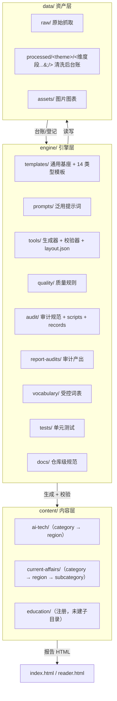

# 软件架构全面评估（ARCHITECTURE-ASSESSMENT 2026-11-16）

> **状态**：现行评估
> **定位**：对 `tech-context-digest` 当前软件架构的一次系统性评估，覆盖分层、边界、通信、数据流、扩展性、维护性、性能、容错、安全九个维度，并给出优化方向与落地路径。
> **配套**：[架构开发规范与流程指引](../docs/architecture-development-standard.md)（评估结论的标准化落地）。
> **评估人**：Agent（妙手）
> **最后更新**：2026-11-16

---

## 〇、评估口径与基线证据

### 0.1 评估方法

- **静态勘察**：通读 `AGENTS.md`、`engine/docs/**`、`engine/tools/**`、`.github/workflows/**`、`.github/actions/**`、`.githooks/**`、`engine/tests/**`。
- **量化采集**：文件数 / 行数 / 测试数 / 跟踪文件数。
- **实跑校验**（全部在本机执行，非引用文档口径）：

| 命令 | 结果 |
|---|---|
| `python -m unittest discover -s engine/tests` | **394 通过 / 1 跳过 / 0 失败**（13.1s） |
| `python engine/tools/validate_layout.py` | 通过 |
| `python engine/tools/check_links.py` | 通过（最终复测） |
| `python engine/tools/page_build_check.py` | **17 页 / 0 [E] / 0 [W]** |
| `python engine/tools/optimization_gate.py` | **0 错误 / 1 警告**（警告项 = `validate`，9 条「业务线缺 data/ 目录」） |
| `python engine/tools/validate.py` | 0 错误 / 9 警告 |
| `python engine/audit/scripts/audit_tool.py run --strict` | **12/12 正式报告 PASS** |
| `python engine/tools/optimization_gate.py --list` | 21 项门禁 |

### 0.2 规模度量（评估时点）

| 指标 | 数值 |
|---|---|
| 跟踪文件 | 432 |
| `engine/` Python | 82 文件 / 13,682 行 |
| 测试文件 | 27 文件 / 394 用例 |
| HTML 报告 | 15 份（12 正式 + 3 legacy）/ 1,295.7 KB |
| Markdown | 189 文件 / 14,267 行 |
| 业务线 | 9 条 |
| 已注册报告类型 | 14 个 |
| 统一门禁项 | 21 项 |
| 工作流 | 6 个（ci / html-sync / content-update / scheduled-maintenance / audit / webhook-alert） |

### 0.3 重要时点说明（并发写）

评估期间工作树处于**活跃变更中**：首次探测时 `check_links` 与 `test_tools.TestCheckLinks` 失败（2 条断链：`content/README.md:10`、`engine/docs/structure-and-naming-spec.md:307`），数分钟后复测全部通过。期间 `README.md`、`content/README.md`、`engine/docs/structure-and-naming-spec.md`、`engine/docs/report-pipeline-system.md` 等 100+ 文件的 mtime 更新（最近 19:25–19:28，评估时刻 19:29）。

**结论**：本仓库正被**并行会话**同时编辑。`repo_sync` 的共享检出锁只保护 git 操作，不保护文件编辑；这正是下文 F-09（多会话并发写同一工作树）的现实证据。本报告的所有结论以「最终复测」为准，但基线会持续漂移。

---

## 一、架构总览

### 1.1 物理分层（事实源：`engine/tools/layout.json` v3.0）

### 1.2 交付形态判定

本仓库**不是**传统「运行态服务」架构，而是 **「静态交付物 + 工具链 + CI 编排」** 架构：

- **交付物**：自包含 HTML 报告（CSS/JS 内联，ECharts 走 CDN 白名单）+ 静态枢纽 `index.html` / `reader.html`。
- **工具链**：`engine/tools/*.py`（82 个脚本，标准库为主，依赖仅 openpyxl / markdown / PyYAML）。
- **编排**：GitHub Actions 六工作流 + 复合动作（submit-pr / workspace-cleanup / remediation-ticket）+ `pre-push` 钩子。
- **「服务间通信」的实际形态**：进程间 `subprocess`（门禁调子进程）、文件契约（JSON/MD/HTML）、Git/PR、GitHub API 与 webhook。**无网络 RPC / 消息队列 / 数据库**。

因此下文「通信机制」「容错」「性能」均按这一形态评估，而非按微服务口径。

---

## 二、分维度评估

### 2.1 架构分层合理性

**现状**：三层（content / engine / data）+ 根级保留项，由 `layout.json` 单一事实源驱动，一级目录白名单由 `validate_layout.py` 强制。

**优点**

- 三层职责定义清晰，判定顺序明确（业务专属 → 跨主题复用 → 数据资产 → 机器生成）。
- 维度序列 `["category","region"]` / `["category","region","subcategory"]` 可声明，`regional_segment=""` 消除「地区分组段」歧义。
- 业务线发现以 `prompts/business-config.md` 为锚点，新增主题 / 业务线无需改代码（已验证）。
- 数据层统一收口 `data/processed/<theme>/<维度段...>`，避免数据散落业务线。

**问题**

| 编号 | 问题 | 证据 | 影响 |
|---|---|---|---|
| F-01 | **校验器与三层架构脱节**：`validate.py` 仍要求每条业务线内含 `data/` 目录 | `engine/tools/validate.py:81-83`；实跑 9 条 `[WARN]`「缺少 data/ 目录」 | 每次门禁固定 9 条噪声警告，掩盖真实问题；口径与 `structure-and-naming-spec` §三「数据不落业务线内」直接冲突 |
| F-02 | **维度规则历史残留**：多份规范仍写「region 先于 category」 | `report-pipeline-system.md:103`、`report-pipeline-implementation-plan.md:131`、`process-vs-infrastructure-governance.md:31` | 规范与代码事实源冲突，新 Agent 易按旧规则建目录 |
| F-03 | **`engine/` 子域过多（12+）且职责有交叉** | `sources/` 与 `content/**/sources/` 并存；`templates/` / `prompts/` / `content/**/prompts/` 三层提示词 | 学习成本高；「源稿该放哪」存在两义性（规范允许两处，但无判定规则） |
| F-04 | **`education/` 主题注册但无内容** | `content/education/.gitkeep` | 无害，但 hub 会显示「暂无报告」，需在规范中明确「空主题是否展示」 |

**结论**：分层设计**方向正确、执行基本到位**，但**存量校验器/文档未完成重构收口**，属于「架构已迁移、守卫未迁移」的典型半迁移状态。

### 2.2 模块边界划分

**现状**：`engine/tools/` 为平铺脚本（41 个 `*.py`）+ 一个正式包 `semantic_checks/`；共享逻辑集中于 `_common.py`（491 行）与 `_quant.py`。

**依赖关系实测**（`from _common import` 统计）：**28 个工具依赖 `_common`**，其中 `build_hub.py`、`source_check.py`、`metric_registry.py`、`compliance_check.py`、`pipeline_runner.py`、`repo_sync.py`、`audit_tool.py` 等核心件全部依赖。跨工具 import 还有：`cycle_clock/market_sizing/monte_carlo/policy_multiplier/signal_synth/transmission/threshold_calibration → _quant`；`semantic_diff → semantic_checks`；`remediation_ticket → optimization_gate + update_planner`。

**优点**

- `_common.py` 统一了目录发现、命名正则、周期解析、Business 模型，避免了重复实现。
- `optimization_gate.py` 把 21 项检查收敛为单一入口，是**优秀的边界收敛**。
- `semantic_checks/` 是标准包结构（`__init__.py` + `base/registry`），可扩展。

**问题**

| 编号 | 问题 | 证据 | 影响 |
|---|---|---|---|
| F-05 | **`_common.py` 职责过重**：布局、命名、周期、量化入口、业务模型、报告发现全在一起（491 行） | `_common.py` | 任何一处改动影响 28 个工具；回归成本高；难以单测隔离 |
| F-06 | **无包结构 + `sys.path.insert` 注入**：`remediation_ticket` 直接 `import optimization_gate`；多数工具 `sys.path.insert(0, tools_dir)` | `remediation_ticket.py:1`、各工具头部 | 依赖 CWD / 导入路径，IDE 与测试支持差；易产生「同一模块被加载两次」（`optimization_gate` 与 `engine.tools.optimization_gate`） |
| F-07 | **双事实源**：报告令牌在 `report_style.py`，hub 令牌在 `build_hub.py::_STYLE` | `page-build-spec.md` §三（由 `test_hub_tokens_match_canonical` 锁定同值） | 靠测试而非结构保证一致，属于「约定式单一事实源」 |
| F-08 | **类型注册三点手工同步**：`template-registry.md` 第二节 + `compliance-rules.json` + `_common.TEMPLATE_TYPE_DIRS` | `structure-and-naming-spec.md` §11.3 | 新增类型易漏改；已有测试覆盖数量但未覆盖三者一致性 |
| F-09 | **`property_type` 命名残留**：房地产专用词被用作通用「细分领域」段 | `_common.py:370`、`classify_reports.py:6,55,69` | 语义漂移；新主题（非地产）使用该产品词汇，可读性差 |

### 2.3 服务间通信机制

**现状**：无网络服务。通信 = `subprocess` + 文件 + Git/PR + GitHub API/webhook。

**优点**

- `optimization_gate` 用 `subprocess.run` 顺序调用 21 个检查，**退出码 0/1/2 统一**，编排器（`pipeline_runner`）只做「节点 → 门禁 → 路由」，不重写校验逻辑（薄编排层）。
- `pipeline_manifest.json` 声明式描述 N0–N8 / G0–G8 / L1-L2，`pipeline_runner` 由清单驱动，图与代码同源。
- CI 侧 `concurrency: auto-commit-main` + `cancel-in-progress: false` 串行化自动提交，避免 push 竞争。

**问题**

| 编号 | 问题 | 证据 | 影响 |
|---|---|---|---|
| F-10 | **`shell=True` 执行外部命令** | `pipeline_runner.py:196`（`_run_command`）、`pipeline_runner.py:255`（`run_node`）、`repo_sync.py:228`（`--checks`） | 命令来源为 manifest（受控）/ 用户传入 checks（不可控）。本地工具风险中等，但属明确注入面 |
| F-11 | **21 次解释器冷启动，串行** | `optimization_gate.py:99`（逐项 `subprocess.run`） | 门禁 wall 时间与检查项数线性相关；实测 `l0_l1_full` p95 ≈ 2.5s（尚可），但扩展后退化 |
| F-12 | **无子进程超时** | `optimization_gate.py:99`、`pipeline_runner.py` | 任一检查挂起（如网络探测）会无限阻塞门禁；`--probe` 虽有 3s/URL 超时，但整体无 wall 上限 |
| F-13 | **`manual` / `ci` 节点不真正执行** | `pipeline_runner.py:260`（`status = {"manual":"manual","ci":"external"}`） | `run --from N0 --to N8` 并非端到端真跑，只是门禁串联；命名易误导使用者以为「一键跑通全流程」 |

### 2.4 数据流转设计

**现状**：主链 N0–N8（需求 → 采集 → 分级 → 分类 → 生成 → 渲染 → 校验审计 → 发布 → 运维），五道防线左移分布。

**优点**

- 单一事实源清单明确（`layout.json` / `report_style.py` / `template-registry.md` / `institution_tiers.json` / `metrics-dictionary.json` / business-config / 台账）。
- 两级 gate-period（内容 2026-12 / 来源 2027-01）实现「历史不追溯、新报告强阻断」，是**优秀的渐进式治理设计**。
- 报告自包含交付，不依赖外部数据文件；台账与报告解耦。

**问题**

| 编号 | 问题 | 证据 | 影响 |
|---|---|---|---|
| F-14 | **数据层无 schema 校验**：`data/processed/**` 的 CSV / JSON / XLSX 仅 `metric_registry` 覆盖指标字典，台账结构靠约定 | `data/processed/**`；`metric_registry.py` | 台账「只增不改」无强制；字段漂移只能在下游报告暴露 |
| F-15 | **`source_registry.json` 是数据层唯一结构化登记，但位置在 `data/processed/`，而规范 §5.1 又把「来源登记」写到 N1 节点** | `report-pipeline-system.md` §N1 vs 实际 `data/processed/<theme>/<维度段...>/source_registry.json` | 概念位置一致，但 `validate.py` 却不校验它（见 F-01） |
| F-16 | **词汇库双写**：`engine/vocabulary/data/**` 由 `sync_vocab.py` 生成（含 imports/exports/backups），同时 `engine/sources/**` 存放源稿 | `engine/vocabulary/`、`engine/sources/` | 「源稿」与「受控词表」边界模糊；F-03 同源 |

### 2.5 可扩展性

**优点**

- 新增主题：`layout.json` 注册 + 建目录，发现/校验/hub 全自动。
- 新增业务线：默认 `content/<theme>/<category>/<region>/` + business-config。
- 新增报告类型：模板目录 + 注册表 + 合规规则（三点）。
- 新增门禁：加入 `optimization_gate.CHECKS`（有测试锁定数量与脚本存在性）。

**问题**

| 编号 | 问题 | 证据 | 影响 |
|---|---|---|---|
| F-17 | **类型注册需改三处** | 见 F-08 | 扩展成本高于「单一登记 + 生成」 |
| F-18 | **hub 类型简称硬编码**：`build_hub.TYPE_SHORT` 14 项手工维护，`parse_type_names()` 解析全称但简称需另写 | `build_hub.py:42-57` | 新增类型忘加简称 → 筛选栏显示生 ID |
| F-19 | **门禁清单硬编码**：新增检查必须改 `optimization_gate.py` 并同步 4 个工作流（测试强制复用） | `optimization_gate.py:41-63`、`test_process_gates.py` | 扩展需改代码 + 测试，无法配置化 |
| F-20 | **维度序列长度决定目录深度**，无「主题级分类」与「业务线」的显式区分字段 | `layout.json`（themes 仅有 name/dimensions/segment） | `content/tech/weekly-roundup/` 这类区域缺省业务线靠 `_walk_upto_depth` 锚点发现，语义靠 `optional_dimensions` 约定 |

### 2.6 可维护性

**优点**

- 394 单测，覆盖门禁复用、提示词继承、审计状态机、页面构建、Git 守卫等关键不变量。
- 规范体系完备（`engine/docs/` 9 份 + `engine/templates/` 通用规范 + AGENTS.md 硬性约束）。
- 工具平均 167 行，粒度合适；`build_hub.py` 797 行是唯一偏大者（含 CSS/JS 模板，可接受）。

**问题**

| 编号 | 问题 | 证据 | 影响 |
|---|---|---|---|
| F-21 | **规范复述导致漂移**：同一事实在 AGENTS.md / structure-and-naming-spec / report-pipeline-system / page-build-spec / governance 多处复述 | F-02 的 5 处残留 | 文档成为「多点事实源」，改一处漏一处 |
| F-22 | **无静态检查（ruff / mypy）**：`workspace_cleanup` 覆盖其缓存，但无配置、无 CI 步骤 | `workspace_cleanup.py` 覆盖 `.ruff_cache`/`.mypy_cache`；`ci.yml` 仅 `py_compile` | 代码质量靠人工；类型错误 / 未用导入无拦截 |
| F-23 | **`report-audits/` 持续累积**：16 份文档，含 14 份 audit-doc 登记件 | `engine/report-audits/` | 时点报告越积越多，无归档 / 轮转策略（仅 `pipeline_runs.jsonl` 有轮转） |
| F-24 | **`engine/docs/adr/` 与 `GLOSSARY.md` 被引用但不存在** | `AGENTS.md:13`、`engine/docs/agents/domain.md`、`check_links.ALLOWED_BROKEN` | 单一上下文（GLOSSARY + ADR）尚未落地，靠 `ALLOWED_BROKEN` 白名单兜底 |

**结论**：可维护性**中上**，但「规范过剩 + 复述」正在成为新的维护负担。

### 2.7 性能表现

**实测数据**（`perf-status.json`，baseline 2026-11-16T11:45:32）：

| 场景 | 平均 wall | p95 | 错误率 |
|---|---|---|---|
| `l0_l1_full`（全量门禁串行） | 2,501 ms | 2,528 ms | 0 |
| `single_report_l1` | 259 ms | 275 ms | 0 |
| `source_check_full` | 346 ms | 351 ms | 0 |
| `build_hub_check` | 115 ms | 116 ms | 0 |
| `audit_run_default`（dry-run） | 172 ms | 197 ms | 0 |
| **`audit_run_strict`（dry-run）** | **160,879 ms（≈161 s）** | **162,199 ms** | 0 |

页面体积：`index.html` 26.4 KB / `reader.html` 34.2 KB（预算 100 KB）；最大报告 212 KB（预算 1.5 MB）。`unittest` 13.1s。

**问题**

| 编号 | 问题 | 证据 | 影响 |
|---|---|---|---|
| F-25 | **`audit_run_strict` 耗时 ≈161 s，且无阈值覆盖** | `perf-status.json`；阈值仅 `l0_l1_full_p95_ms=60000`，未覆盖 strict 审计 | 该场景在 `audit.yml` 关键路径上，CI 单次运行被显著拖长；cpu_ms 仅 15.6 → 主要耗在 I/O / 网络探测等待 |
| F-26 | **`build_hub` 每主题读全量报告 HTML 正文** | `build_hub.py:562`（`read_text` 取 title） | 报告数 / 体积线性增长；当前 1.3 MB 无感，规模化后退化 |
| F-27 | **门禁无并行 / 无缓存** | `optimization_gate.py` | 21 项全部重跑；变更后无法只跑受影响项（除手工 `--only`） |

### 2.8 容错能力

**优点**

- 退出码统一 0/1/2，`set +e` + 取值判定在 CI 中一致实现。
- 共享检出锁：`O_EXCL` + TTL 600s + PID 存活检测 + stale 清理。
- `repo_sync.run`：先 commit 再 sync，rebase 冲突 `abort` 并保留本地提交。
- CI pip install 重试（`nick-fields/retry`，2 次）。
- 审计 L3 宽限期 14 天 + 标识三态（none/pre/full），fail-fast 与宽限平衡。
- 闭环修正工单（`remediation_ticket`）幂等，覆盖全部门禁异常。

**问题**

| 编号 | 问题 | 证据 | 影响 |
|---|---|---|---|
| F-28 | **无子进程超时**（同 F-12） | `optimization_gate.py` | 单点挂起 → 整个门禁挂起，无自愈 |
| F-29 | **锁不覆盖文件编辑**（同 F-09） | `repo_sync.locked` 仅包 git 流程 | 并行会话可同时改同一文件，后写覆盖先写（本次评估即观察到） |
| F-30 | **`submit-pr` 推送失败重试 3 次 + `--force` 兜底** | `submit-pr/action.yml:89-96` | 对 CI 分支 force push 可接受，但重试策略固定、无退避上限 |
| F-31 | **`remediation_ticket` 依赖门禁输出文本推断责任周期** | `remediation_ticket.py` | 输出格式变化会导致工单归类错误 |

### 2.9 安全性

**优点**

- **依赖锁定**：`requirements.txt` 精确版本（openpyxl 3.1.5 / markdown 3.11.3 / PyYAML 6.0.3）。
- **Actions 固定 SHA**：checkout / setup-python / github-script 均 pinned。
- **CDN 白名单**：仅 `cdn.jsdelivr.net`（echarts）。
- **iframe 白名单**：`reader.html?report=` 仅接受列表内已知路径，防任意 `src` 注入。
- **输出转义**：`build_hub._esc` = `html.escape(quote=True)`。
- **权限最小化**：CI `permissions` 按需 write；PR 用 `CI_PR_TOKEN`。
- **密钥**：webhook / PR token 走 `secrets`，无硬编码。
- **审计留痕**：append-only + sha256 发布指纹 + 只追加 reviews。
- **Git 托管约束**：硬编码禁止 GitLab remote（`repo_sync.gitlab_remote_blocked`）。

**问题**

| 编号 | 问题 | 证据 | 影响 |
|---|---|---|---|
| F-32 | **`shell=True` 注入面** | 同 F-10 | 本地 CLI 工具，信任边界内；但 `--checks` 由用户传入，应改用列表参数或 shlex |
| F-33 | **报告内容 XSS 面**：报告为手写 HTML，来源 URL 直接进 `href` | 报告由 Agent 生成 | 自包含同源，风险低；但 `javascript:` 协议 URL 无校验（`source_check` 只判可达性，不判协议） |
| F-34 | **`webhook-alert`  secrets 透传** | 各工作流 `secrets.AUTOMATION_WEBHOOK_URL` | 若 webhook URL 泄露可被滥用；建议加签名 / 限流（超出本仓库范围） |
| F-35 | **审计记录含 `run_url` / 仓库名** | `automation-status.json` | 公开仓库下无敏感信息；私有仓库需确认 |

**结论**：安全性**良好**，供应链与注入面均有意识；主要改进点是 `shell=True` 与 `javascript:` 协议校验。

---

## 三、问题清单（按优先级）

| 优先级 | 编号 | 问题 | 影响面 |
|---|---|---|---|
| **P0** | F-09 / F-29 | 多会话并发写同一工作树，锁不覆盖文件编辑 | 数据覆盖、基线漂移（本次评估实测） |
| **P0** | F-01 | `validate.py` 与三层架构脱节（9 条固定误报） | 门禁噪声、口径冲突 |
| **P1** | F-02 | 维度规则历史残留 5 处 | 新 Agent 按旧规则建目录 |
| **P1** | F-05 / F-06 | `_common` 过重 + 平铺脚本无包结构 | 回归成本、IDE/测试支持差 |
| **P1** | F-25 / F-12 / F-28 | strict 审计 161s 无阈值；门禁无超时 | CI 时长、单点挂起 |
| **P1** | F-08 / F-17 / F-18 / F-19 | 类型 / 门禁注册多点手工同步 | 扩展漏改 |
| **P2** | F-21 | 规范复述导致漂移 | 文档可信度 |
| **P2** | F-22 | 无 ruff / mypy 静态门禁 | 代码质量 |
| **P2** | F-14 / F-16 | 数据层无 schema；词表/源稿边界模糊 | 数据一致性 |
| **P2** | F-23 / F-24 | 审计文档累积；ADR/GLOSSARY 未落地 | 可维护性 |
| **P3** | F-03 / F-04 / F-07 / F-13 / F-15 / F-20 / F-26 / F-27 / F-30 / F-31 / F-32 / F-33 | 命名残留、双事实源、节点语义、体积、重试、协议校验等 | 渐进改进 |

---

## 四、优化方向与具体方案

### 方向 A：事实源收敛（解决 F-01 / F-02 / F-21）

- **目标**：每个事实只在一处定义，其余位置一律「指针」。
- **方案**
  1. 修 `validate.py`：删除业务线 `data/` 目录校验，改为校验 `data/processed/<theme>/<维度段...>/` 存在性（复用 `_common.processed_data_dir`）；文案去掉「物业类型」。
  2. 修 5 处 region-first 残留：`report-pipeline-system.md` §N0/N1/N3、`report-pipeline-implementation-plan.md` N0、`process-vs-infrastructure-governance.md` §二。
  3. 建立「规范上位—下位」关系：AGENTS.md 只留硬性约束清单 + 指针；细节只在专用规范。
- **影响面**：`engine/tools/validate.py`、4 份 md、`engine/tests/test_tools.py`（可能需更新断言）。
- **风险**：低。验收：`validate.py` 0 警告；`check_links` / `unittest` 全绿。

### 方向 B：工具链包化与共享内核拆分（解决 F-05 / F-06 / F-09）

- **目标**：`engine/tools` 从「平铺脚本 + sys.path 注入」升级为可导入包。
- **方案**
  1. 引入 `engine/tools/` 的 `__init__.py`（或独立 core 包），把 `_common.py` 拆为 `layout.py` / `naming.py` / `period.py` / `models.py` / `quant.py`。
  2. 统一导入方式：`from engine.tools._common import ...` 或相对导入；删除 `sys.path.insert`。
  3. 为 `optimization_gate` 提供 in-process 调用入口（`run_checks` 已有），减少 `subprocess`。
- **影响面**：28 个工具 + 27 个测试。
- **风险**：中（导入路径回归）。验收：`unittest` 全绿 + 新增「无 sys.path 注入」测试。

### 方向 C：门禁性能与健壮性（解决 F-11 / F-12 / F-25 / F-28）

- **目标**：门禁可扩展、可观测、单点不挂死。
- **方案**
  1. `subprocess.run(..., timeout=...)`：为每类检查设 wall 上限（结构类 30s / 探测类 120s）。
  2. 结构性检查改 in-process（同进程 import），仅 `source_check --probe` 保留子进程 + 并行。
  3. `perf_monitor` 阈值扩展：新增 `audit_strict_p95_ms`（建议 ≤ 180s）与 `gate_total_p95_ms`。
  4. 门禁支持 `--affected`（按变更路径筛选检查项），供 CI 增量使用。
- **影响面**：`optimization_gate.py`、`perf_monitor.py`、`perf-status.json`、CI。
- **风险**：低—中。验收：`audit_run_strict` p95 下降且阈值校验通过；挂起场景有超时退出。

### 方向 D：注册结构化（解决 F-08 / F-17 / F-18 / F-19）

- **目标**：类型 / 门禁单一登记，其余生成。
- **方案**
  1. 在 `engine/tools/` 新建 `registry.json`（或扩展 `layout.json`）登记类型：`type_id → {name, short, cadence, template_dir, compliance}`。
  2. `template-registry.md` 第二节、`compliance-rules.json`、`_common.TEMPLATE_TYPE_DIRS`、`build_hub.TYPE_SHORT` 由登记生成（或至少由测试强制一致）。
  3. `optimization_gate.CHECKS` 由清单文件加载，测试锁定「清单 == 代码」。
- **影响面**：模板 / 合规 / hub / 门禁 / 测试。
- **风险**：中。验收：新增类型只改一处；一致性测试通过。

### 方向 E：数据层 schema 化（解决 F-14 / F-16）

- **目标**：台账 / 登记 / 量化数据有结构契约。
- **方案**
  1. 为 `source_registry.json` 定 JSON Schema（已有 `engine/quality/manifest.schema.json` 先例）。
  2. 台账（`*_ledger.md`）定「头部元数据块 + 追加表」契约，由 `metric_registry` 或新 `ledger_check` 校验。
  3. 明确 `engine/sources/`（通用源稿）与 `content/**/sources/`（业务源稿）的判定规则并写入规范。
- **影响面**：`data/processed/**`、`engine/tools/*`、规范。
- **风险**：低。验收：schema 校验纳入统一门禁（`[W]` 起步）。

### 方向 F：静态质量纳入统一入口（解决 F-22）

- **目标**：代码质量有硬约束。
- **方案**：`ruff`（lint + format 检查）+ `mypy`（关键模块）纳入 `optimization_gate`（默认 `[W]`，稳定后升 `[E]`）；CI 装依赖。
- **影响面**：`requirements.txt`、`optimization_gate.py`、`ci.yml`。
- **风险**：低。验收：新增检查项 + 测试锁定。

### 方向 G：规范体系分层与归档（解决 F-21 / F-23 / F-24）

- **目标**：规范可扩展、可检索、不过期。
- **方案**
  1. 规范分三层：上位（AGENTS.md 硬性约束）→ 体系（report-pipeline-system）→ 专用（page-build / naming / 信息分层）。
  2. `report-audits/` 时点报告加 `YYYY-MM` 归档子目录，保留最近 12 个月在根；由 `scheduled-maintenance` 轮转。
  3. 落地 `GLOSSARY.md` + `engine/docs/adr/`（0001 起），或从 AGENTS.md 移除引用。
- **影响面**：文档结构、`archive_reports.py`（扩展）。
- **风险**：低。验收：AGENTS.md 引用全部可达；归档幂等。

---

## 五、落地实施路径

| 阶段 | 目标 | 关键任务 | 依赖 | 产出 | 验收标准 |
|---|---|---|---|---|---|
| **P0 立即** | 恢复并稳定基线 | 完成在途迁移；修 `validate.py`（F-01）；清理 5 处 region-first 残留（F-02） | 无 | 分支提交 | `unittest` 394 全绿；`validate` 0 警告；`check_links` 通过 |
| **P1 第 1 周** | 并发安全 + 门禁健壮 | 文件编辑锁 / 会话协调（F-09）；门禁超时（F-12）；strict 审计阈值（F-25） | P0 | `repo_sync` 扩展、`optimization_gate` 扩展 | 并行会话无覆盖；挂起有超时；`audit_strict` 有阈值 |
| **P2 第 2 周** | 包化 + 注册结构化 | `engine/tools` 包化（F-05/06）；类型登记单一化（F-08/17/18）；门禁清单配置化（F-19） | P1 | 新包结构、`registry.json` | 无 `sys.path` 注入；新增类型改一处 |
| **P3 第 3–4 周** | 数据与静态门禁 | 数据 schema（F-14）；ruff/mypy（F-22）；规范分层与归档（F-21/23/24） | P2 | schema、门禁扩展、归档 | schema 纳入门禁；静态检查通过；文档可达 |
| **P4 持续** | 演进 | 性能优化（F-26/27）；安全加固（F-32/33）；ADR/GLOSSARY | P3 | 迭代 | 阈值达标、无注入面 |

**实施纪律**（沿用既有协议）

- 每个阶段在 `task/<slug>` 分支提交，经 `python engine/tools/repo_sync.py run --message ... --paths ... --gate`，PR 合并。
- 阶段内新增检查默认 `[W]`，稳定一个迭代后评 `[E]`（见 governance §三）。
- 破坏性变更（包化、注册结构化）走并行期：新旧入口并存一个迭代，测试同时放行。

---

## 六、结论

1. **架构方向正确**：三层 + 单一事实源 + 门禁左移 + 两级 gate-period，是一套**成熟度高于多数同规模知识库仓库**的治理设计。
2. **主要矛盾是「迁移未收口」**：三层重构与 category-first 规则已落地，但 `validate.py` 与 5 处规范仍在旧口径，导致固定误报与规范冲突（F-01/F-02）。
3. **主要风险是「并发写」**：多会话共享工作树，锁只覆盖 git 不覆盖文件编辑（F-09/F-29），本次评估已实测到基线漂移。
4. **主要性能隐患是 strict 审计**：161s 且无阈值（F-25），位于 CI 关键路径。
5. **落地优先级**：P0 收口迁移 → P1 并发安全与门禁健壮 → P2 包化与注册结构化 → P3 数据与静态门禁 → P4 演进。

> 本报告结论与[架构开发规范与流程指引](../docs/architecture-development-standard.md)配套使用：评估回答「现在是什么、问题在哪」，规范回答「以后必须怎么做」。
