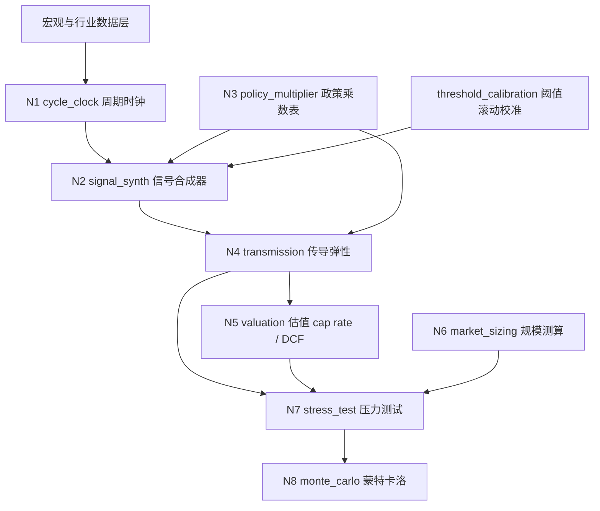

# 量化研究体系优化实施方案（可落地 · 可量化 · 可验证）

> **状态**：已落地（实施结果见 [量化实施完成报告](quant-implementation-completion-report-2026-11-14.md)）
> **交付定位**：把 `tech-context-digest` 的「指标监测型框架」升级为「周期定位 + 传导建模 + 资产定价」的分析型框架。
> **上游依据**：[框架诊断报告](framework-diagnostic-2026-11-14.md)（六项发现 F1–F6、实测健康度基线）。
> **基准日**：2026-11-14（T0）｜ **适用范围**：经济分析模块（`content/economy/dubai/apartment` 旗舰、`content/economy/global/trends`）+ 行业研究体系（全谱系报告类型）。
> **证据边界**：仅基于仓库内已提交文件与既有实跑结果；不引入未核验外部数据。**标注约定**：【事实】仓库可回溯；【推断】机制分析；【待补】需新增数据或核验。
> **硬性约束**：不得违反通用基座「结论边界」；来源语言规则（英文一手）；`AGENTS.md` 页面构建规范与category-first 维度规则。
> **最后更新**：2026-11-16

---

## 一、模型迭代规划

### 1.1 链路与依赖

固定顺序：**周期时钟 → 信号合成器 → 政策乘数表 → 传导弹性 → 估值 → 规模测算 → 压力测试 → 蒙特卡洛**；「政策乘数表」与「规模测算」为旁路输入。



**依赖原则**：下游模块只读上游的结构化输出（JSON/CSV），不直接读上游内部状态；任一节点失败不得静默降级，须以退出码 1（错误）或 2（警告）显式上报。

### 1.2 节点总表

| 节点 | 模块 | 优先级 | 交付物 | 关联 KPI |
|---|---|---|---|---|
| N1 | 周期时钟 | **P0** | `cycle_clock.py`；周报 s2.0「周期定位」节 | KPI-1 |
| N2 | 信号合成器 | **P0** | `signal_synth.py`；K 系列三层重组；合成结果入台账 | KPI-1、KPI-6 |
| N3 | 政策乘数表 | **P0** | `policy_multiplier.py`；business-config「政策乘数」节；G01–G05 核验状态 | KPI-2 |
| N4 | 传导弹性（OLS+VAR） | **P1** | `transmission.py`；四链弹性 / 时滞 / CI；回测脚本 | KPI-3 |
| N5 | cap rate / DCF 估值 | **P1** | `valuation.py`；apartment 年度「估值」节 | KPI-3 |
| N6 | 规模测算 | **P1** | `market_sizing.py`；`market-sizing` 首个实例 | KPI-4 |
| N7 | 压力测试 | **P2** | `stress_test.py`；尾部情景库 | KPI-3、KPI-5 |
| N8 | 蒙特卡洛 | **P2** | `monte_carlo.py`；分布 + VaR/ES | KPI-3、KPI-5 |

> 所有新增模块落地既有 `engine/tools/`，测试落地既有 `engine/tests/`，不新建平行工具链。

### 1.3 关键验收口径（摘要）

- **N1**：阶段集合 = {复苏, 过热, 滞胀, 衰退, 过渡带}，规则显式可复现；覆盖增长 / 通胀 / 政策 / 流动性 ≥4 维；同输入两次运行逐字节一致（无时间戳 / 随机）。
- **N2**：K01–K15 全部归类领先 / 同步 / 滞后，层内权重和为 1；输出「周期阶段 + 信号一致性」，与 `cycle_clock` 阶段冲突时显式告警；与既有「五态」兼容。
- **N3**：政策核验覆盖率 ≥4/5；每条已核验政策给出乘数区间或标注「不可估（数据不足）」；政策原文取条款页 / PDF 并记录哈希；政策变更触发情景重算。
- **N4**：≥3/4 链给出「弹性 + 时滞 + 95% CI」三件套；OLS 与 VAR 并列；样本外回测误差如实标注；显式提示机制历史短导致的宽置信区间。
- **N5**：净口径修正显式列出；Fed 路径作为显式外生输入；输出估值区间 + 敏感性；cap rate 与 DCF 交叉验证，差异 >20% 时给出解释。
- **N6**：双口径差异 <30% 且有解释；所有假设可审计（来源 + 数值 + 时点）；输出「可审计测算模型」。
- **N7 / N8**：≥5 尾部情景且各有可观测触发条件、输出损失区间；≥10,000 次模拟且固定种子可复现，输出分布 + VaR/ES。

---

## 二、数据扩充清单（11 维）

完整可执行清单（含权威来源、频率、优先级、口径、获取方式、状态）见 [data-acquisition-checklist.md](data-acquisition-checklist.md)。优先级口径：**P0** = Phase 1 必须上线；**P1** = Phase 2；**P2** = Phase 3。

**采集 SOP**：登记 → 取数（记录发布日期 / 页码 / PDF SHA-256）→ 双源（进入合成须 ≥2 独立来源方向一致）→ 入库（`status ∈ {已核验, 部分核验, 未核验}`）→ 消号（未核验转盲区台账）→ 巡检（每季度核对 URL 可达性）。

**与现有台账衔接**：既有指标 ID 体系（`P*` 价格、`S*` 供需、`R*` 租赁、`M*` 宏观先行、`G*` 政策）保持不变；新增「信号合成」「发布日历」工作表。

---

## 三、全流程标准化建设

### 3.1 闭环

```
触发 → 采集 → 核验 → 分析 → 产出 → 门禁 → 归档 → 回测 →（回到触发）
```

### 3.2 四项核心新机制

| 机制 | 要点 |
|---|---|
| **M1 预期差触发** | 预期差 = 实际 − 预期（市场一致预期 / 上期预测 / 官方前值三者之一）；阈值 \|差\| > 1σ 或超官方前值 20%；触发后 3 个工作日内开专题，输出预期差台账 |
| **M2 发布日历** | 各来源发布时点 / 滞后 / 复审日集中管理；新来源入库即登记；每季度核对；发布后 T+N 日内入库；漏采触发告警（见 [release-calendar.md](release-calendar.md)） |
| **M3 双源交叉确认** | 进入信号合成的数值须 ≥2 个独立来源方向一致；口径冲突并列呈现，禁止合并为单一数值；官方 PDF 记录 SHA-256 / 发布日期 / 页码 |
| **M4 研究内核门禁** | CI 检查新增报告四项必填：周期定位 / 传导量化（弹性 + 时滞）/ 政策入模 / 盲区列示；缺项 `[E]`，表述不充分 `[W]`；历史报告降级警告 |

---

## 四、动态监测体系

### 4.1 三层监测频率

| 层级 | 频率 | 监测对象 | 载体 |
|---|---|---|---|
| 高频层 | 周 | 市场情绪、挂牌、搜索、航班、油价、利率、金价 | `trend-weekly` 周报 |
| 中频层 | 月 | 官方宏观、成交、租金、信贷、旅游 | `market-monitoring` 月度 |
| 低频层 | 季 / 年 | 周期定位、政策、估值、规模、回测 | 季度 / 年度报告 |

### 4.2 K 系列三层重组

| 层 | 权重 | K 编号 |
|---|---|---|
| **领先** | 0.50 | K01 3M EIBOR、K02 Fed 票型 / 点阵图、K03 许可建筑面积同比、K05 新推盘量同比、K06 降租续约占比、K11 FDI 流入同比、K12 人口 / 家庭增速、K13 就业 / 失业 |
| **同步** | 0.35 | K04 交付兑现率、K07 公寓中位价同比、K08 成交量同比、K09 现房成交金额占比、K14 酒店入住率 / 游客 |
| **滞后** | 0.15 | K10 登记口径毛收益率、K15 官方 GDP/CPI 分歧 |

> 合成规则：层内按指标个体权重（一等 / 二等 / 三等 = 0.5/0.3/0.2）归一；输出「层计数 + 方向一致性」；与 `cycle_clock` 阶段交叉校验，冲突即告警。

### 4.3 阈值滚动校准

- **窗口 / 频率**：滚动 36 个月（数据不足用全样本并标注样本量）；每 6 个月一次（6 月 / 12 月）。
- **对象**：K01–K15 与 RL-01–RL-09 的阈值分位数；用「状态计数」（首次进入 + 持续时长）替代「触发计数」。
- **工具**：`threshold_calibration.py`，输出校准记录（旧阈值、新阈值、依据分位、样本量、变更理由）。
- **硬约束**：阈值变更不得事后改写；历史阈值与变更记录留痕。
- **回测**：2027-06 中期回测（提前于原计划 2027-12），2027-12 全期回测。

### 4.4 盲区滚动台账与消号闭环

字段：盲区 ID、项目、影响、发现日期、责任周期、消号条件、状态、关联 KPI。消号条件见 [blind-spot-ledger.md](blind-spot-ledger.md)；每月复盘会审一次，季度报告公布状态。

---

## 五、三阶段路线图与 KPI

| 阶段 | 周期 | 目标 | 阶段 gate |
|---|---|---|---|
| **Phase 1 补理论** | T0 → 2026-12-14 | 周期定位 + 政策核验 + 数据层 P0 | N1/N2/N3 交付；KPI-1 ≥50%；KPI-2 ≥80%；内核门禁接入 CI |
| **Phase 2 补模型** | 2026-12-15 → 2027-02-14 | 传导弹性 + 估值 + 规模 | KPI-1 100%；KPI-3 3/4；KPI-4 ≥4/13；KPI-6 ≥50% |
| **Phase 3 补实例** | 2027-02-15 → 2027-05-14 | 类型扩充 + 压力 + 蒙特卡洛 + 回测 | 7/7 KPI 达标 + 门禁 0E + unittest 全绿 |

| # | KPI | 现状 | 目标 | 度量方式 |
|---|---|---|---|---|
| KPI-1 | 周期定位覆盖率 | 0% | 100%（周报 + 月报均含阶段判定） | 含 s2.0 节的报告数 / 报告总数 |
| KPI-2 | 政策核验覆盖率 | 20%（1/5） | ≥80%（≥4/5） | business-config G01–G05 核验状态表 |
| KPI-3 | 传导量化覆盖维度 | 0/4 | 3/4 | `transmission.py` 输出四链字段 |
| KPI-4 | 类型实例数量 | 3/13 | 7/13 | 类型实例统计（注册表 + 业务线配置引用） |
| KPI-5 | 变量盲区数 | 14 项 | ≤6 项 | 盲区台账状态汇总 |
| KPI-6 | 阈值回测覆盖 | 0% | ≥50% → 100% | `threshold_calibration.py` 回测报告 |
| KPI-7 | 报告工程门禁 | 0E | 0E 维持 | `page_build_check` + `compliance_check` + CI |

**可验证性原则**：所有 KPI 必须能由仓库内脚本或明确文件复核，禁止以主观判断作为验收依据；模型输出必须确定性（固定种子、无时间戳）。

---

## 六、风险与边界

1. **理论适用性**：投资时钟源于发达市场，海湾经济体（资源型 + 钉住汇率 + 外籍人口主导）须本土化校准。
2. **数据可得性**：迪拜官方数据碎片化，空置率 / 竣工可能永远无官方序列 → 用高频代理替代并记录校准方式。
3. **回测局限**：机制历史短（2 期），弹性置信区间必然偏宽，须如实标注，禁止过度拟合。
4. **样本量限制**：OLS/VAR 在小样本下不稳，须报告滞后阶数选择依据与稳健性检验。
5. **政策敏感性**：官方站点可访问性受限，核验为长期投入。
6. **合规边界**：不得输出买卖价位 / 杠杆 / 仓位建议；来源语言规则（英文一手）不变。

---

## 附录：证据索引

| 结论 | 证据 |
|---|---|
| 六项发现 F1–F6 与实测基线 | [framework-diagnostic-2026-11-14.md](framework-diagnostic-2026-11-14.md) |
| K01–K15 / RL-01–RL-09 / G01–G05 | `content/economy/dubai/apartment/prompts/business-config.md` |
| 指标来源与口径（P/S/R/M 系） | `content/economy/dubai/apartment/script/build_registry_v1.py` / `v2.py` |
| 类型与合规矩骨架 | `engine/templates/template-registry.md`、`compliance-rules.json` |
| 实施结果 | [quant-implementation-completion-report-2026-11-14.md](quant-implementation-completion-report-2026-11-14.md) |

## 版本记录

| 版本 | 日期 | 变更 |
|---|---|---|
| v1.0 | 2026-11-14 | 初始方案（455 行） |
| v1.1 | 2026-11-16 | 精简：合并节点详细规格为验收摘要，链接到已落地工具与清单；标注「已落地」 |
